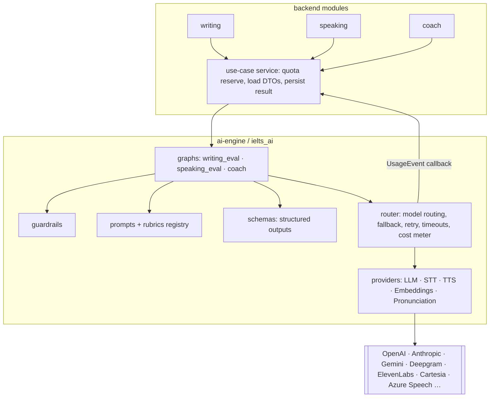
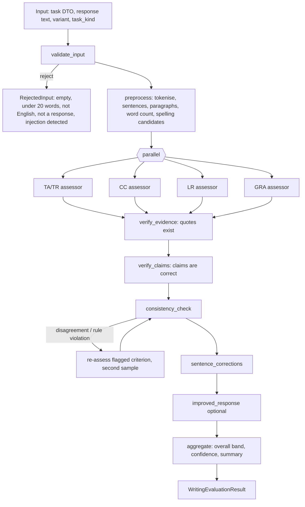
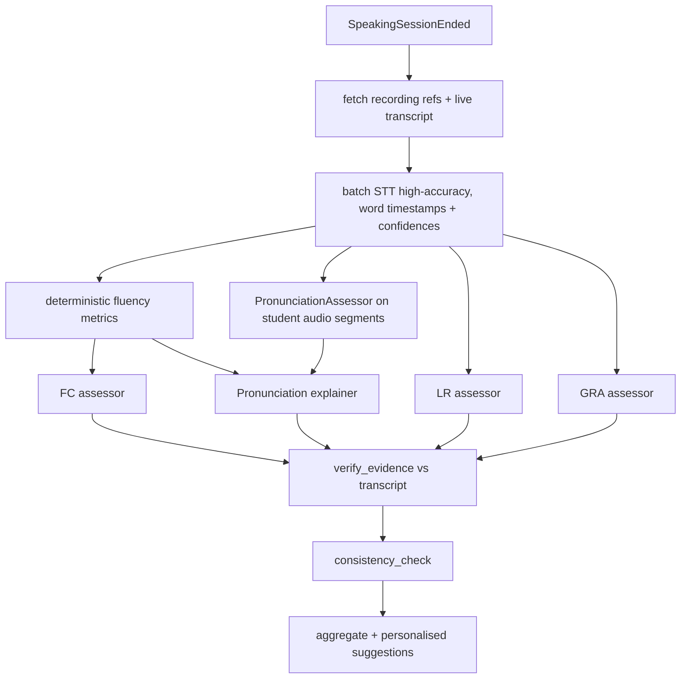

# IELTS MASTER 2.0 — AI Engine Architecture

> **Implementation status (2026-11-19):** `ielts_ai.graphs.evaluation` (Writing and Speaking evaluation: guarded, delimited prompts; `generate_structured` into Pydantic models; criteria must match the published rubric; quoted excerpts must occur in the response; overall band computed in code; pronunciation only from a `PronunciationAssessor`), `ielts_ai.guardrails.input`, prompts `writing/evaluate@1.0.0` and `speaking/evaluate@1.0.0`. **No provider adapter exists yet (D-07):** the backend resolves providers in `app/core/ai.py`; with none registered, evaluations end `unavailable`. All tests use fake providers; nothing has been verified against a real model.

| Field | Value |
|---|---|
| Status | **Draft v0.2 — revised after Phase 1 audit; awaiting approval** |
| Package | `ai-engine/` → `ielts_ai` (pure library, no DB — ADR-003) |
| Related | `REALTIME_SPEAKING_ARCHITECTURE.md`, `DATABASE_SCHEMA.md` §6, `TESTING_STRATEGY.md` §5 |
| Last updated | 2026-11-17 |

---

## 1. Scope

| Capability | Mechanism | Runs in |
|---|---|---|
| Writing evaluation | LangGraph workflow | `ai_writing` Celery workers |
| Speaking post-session evaluation | LangGraph workflow + deterministic audio metrics + pronunciation assessor | `ai_speaking` workers |
| Learning coach (chat + plan generation) | LangGraph agent with read-only tools + RAG | API (streaming chat) / workers (plans, weekly summary) |
| Practice hints, follow-up questions, simple rewrites | Single `LLMProvider` call with structured output | API or workers |
| Voice conversation | STT/LLM/TTS providers inside LiveKit agent (optional `RealtimeVoiceProvider`, ADR-015) | `voice-engine` |
| Embeddings | `EmbeddingProvider` | workers (ingest), API (query) |

## 2. Layering



The backend passes in a `UsageSink` callback. Every provider call emits a `UsageEvent` (provider, model, tokens, audio_ms, latency, cost estimate, correlation_id), which the backend persists to `ai_requests`. That keeps the library DB-free while making all usage metered.

## 3. Provider Abstraction

```python
class LLMProvider(Protocol):
    capabilities: LLMCapabilities   # structured_output, tool_calling, streaming, vision, max_context, json_schema_strict
    async def generate(self, req: LLMRequest) -> LLMResponse: ...
    async def generate_structured(self, req: LLMRequest, schema: type[T]) -> StructuredResult[T]: ...
    def stream(self, req: LLMRequest) -> AsyncIterator[LLMChunk]: ...

class STTProvider(Protocol):        # batch + streaming variants; word timestamps & confidences capability flags
class TTSProvider(Protocol):        # streaming synthesis; voices; sample rates
class EmbeddingProvider(Protocol):  # dims, max_batch
class PronunciationAssessor(Protocol):  # audio + reference/unscripted → phoneme/word/fluency scores
class RealtimeVoiceProvider(Protocol):  # optional speech-to-speech session (ADR-015); must emit transcripts + turn events
```

- **Capabilities are declared, never assumed.** A route requiring `json_schema_strict` only selects providers advertising it. Otherwise the router uses the fallback strategy "JSON mode + Pydantic validation + one repair attempt".
- Adapters are thin. LangChain chat-model integrations may be used inside adapters where they save effort, but graphs depend only on our protocols.
- **Routing config** (`provider_routes`, admin-editable, cached; loaded by the backend, or by the voice engine via the internal API, and **passed into** the router, so `ielts_ai` never reads the DB): `feature → [ {provider, model, params, weight} … ]` ordered by priority. Examples: `writing.criterion` → primary + fallback, `voice.llm` → fastest low-latency model.
- **Resilience:** per-call timeout, retry with backoff on retryable errors (429/5xx/timeouts) honouring `Retry-After`, a circuit breaker per provider (Redis-shared state), and fallback to the next route entry. Fallback is recorded on the evaluation (`result.meta.fallback_used`) because a model change may shift scores.
- **Concurrency limits** per provider (Redis semaphore) to stay under account rate limits. Backpressure: queue depth alerts and quota-aware admission (§9).

## 4. Writing Evaluation Graph



### 4.1 Node details

| Node | Kind | Notes |
|---|---|---|
| `validate_input` | deterministic + small LLM classifier | Language detection, min length, off-topic detection (embedding similarity to the prompt + classifier), prompt-injection heuristics. The essay is treated as **data**, wrapped in delimiters, and never followed as instructions. |
| `preprocess` | deterministic | Sentence/paragraph segmentation with character offsets (used for evidence spans). Under-length flag (Task 1 < 150, Task 2 < 250 words). |
| Criterion assessors | LLM, structured output | One prompt per criterion with the **current public IELTS Writing band descriptors** (the version in force, tracked as a versioned rubric file; usage terms are open decision D-16) embedded. Output: `band`, `descriptor_matches[]` (which descriptor statements are met), `strengths[]`, `weaknesses[]`, each with `evidence: [{quote, start, end}]`. Task 1 TA also receives `key_features` from the task to detect missing information. |
| `verify_evidence` | deterministic | Every quote must appear verbatim (after whitespace normalisation) in the response at the claimed offsets. Unlocatable claims are **dropped**, and if a criterion loses most of its evidence it is re-assessed. **This proves only that the cited text exists, not that the claim about it is correct.** |
| `verify_claims` | mixed | Checks that a located claim is *true*. (a) **Error claims** (grammar/spelling/word-form/collocation): spelling claims are cross-checked with a deterministic spell-checker, and grammar/vocabulary claims are re-judged by an independent verifier call that sees only the sentence and the claim and must answer `valid / invalid / uncertain` (blind to the band). Invalid claims are dropped, and uncertain ones are kept only as softened suggestions. (b) **Correction claims:** the correction must differ from the original and must not introduce new errors (re-check). (c) **Task claims** (e.g., "the essay does not address X"): checked against the prompt's required parts / Task 1 `key_features`. (d) **Positive claims** are checked the same way, since over-praise is also a hallucination. Drop rates are logged per criterion and monitored as a quality signal. |
| `consistency_check` | deterministic rules | Band ∈ {0…9 step 0.5}. Rubric constraints (e.g., an under-length response caps TA/TR, a fully off-topic response caps TR, a memorised/irrelevant response is flagged). Score dispersion check: if a second sample differs > 1.0 band, take a third and use the median. |
| `sentence_corrections` | LLM, structured | Per-sentence edits with category, original span, corrected text, and a short explanation. The span is verified like evidence. |
| `improved_response` | LLM | A rewritten version at target band (student target or current+1), clearly labelled as a model rewrite. Gated by plan entitlement. |
| `aggregate` | deterministic | Criterion bands → overall (mean, IELTS rounding — shared `banding` util). `confidence` derived from sample agreement and evidence retention. |

### 4.2 Output contract (abridged)

```python
class CriterionAssessment(BaseModel):
    criterion: Literal["TA","TR","CC","LR","GRA"]
    band: Band                        # constrained decimal 0–9 step .5
    descriptor_matches: list[str]
    strengths: list[EvidencedPoint]
    weaknesses: list[EvidencedPoint]

class WritingEvaluationResult(BaseModel):
    criteria: list[CriterionAssessment]
    overall_band: Band
    confidence: float                 # 0–1
    corrections: list[SentenceCorrection]
    vocabulary_suggestions: list[VocabSuggestion]
    missing_key_features: list[str]   # Task 1
    summary: str
    improved_response: str | None
    disclaimer: Literal["AI_ESTIMATE_NOT_OFFICIAL"]
    meta: EvaluationMeta              # graph_version, prompt_versions, models, fallback_used, samples
```

### 4.3 Cost & latency control

- Criterion assessors run in parallel (LangGraph fan-out). Target p95 < 90 s (NFR-PF-05).
- A second sample runs only when the first is borderline or rules are violated (estimated 15–25% of essays).
- Prompt caching (where the provider supports it) for the long static rubric prefix.

## 5. Speaking Evaluation Graph (post-session)



- **Deterministic metrics** (no LLM): speech rate (wpm, articulation rate), pause count/length distribution, mean length of run, filler words (from a curated list + STT disfluency tokens), repetitions and self-corrections (n-gram repeats within a window), response length per part, Part 2 long-turn duration.
- **Pronunciation** (ADR-011): `PronunciationAssessor` returns accuracy/fluency/prosody and word/phoneme-level problem items. The **band for Pronunciation is derived by a calibrated mapping** from assessor scores. It is fitted on a human-rated *calibration* split and validated on a separate held-out split (§8.1). Until the calibration set is large enough to cover bands 4–8 adequately (target ≥ 300 rated speaking samples, with ≥ 30 per band), the pronunciation result is shown as a **descriptive profile plus a wide band range**, not a single band. The mapping is versioned with the assessor model, and the LLM only explains it ("you consistently reduced the /θ/ sound in 'think' → 'tink' at 02:14"), citing word timestamps that link to audio playback.
- **STT errors are not student errors.** Grammar/vocabulary error claims on words with low STT confidence (below a calibrated threshold) or where live and batch transcripts disagree are dropped or softened. This prevents transcription mistakes being reported as the student's mistakes.
- Transcript-based criteria (FC, LR, GRA) use the same evidence- and claim-verification pattern as writing, with quotes tied to turn IDs + timestamps.
- Audio never leaves our storage/provider pipeline except to configured processors covered by the privacy policy.

## 6. Learning Coach Agent

- LangGraph agent with **read-only tools** backed by the backend through an injected tool interface: `get_module_stats`, `get_skill_stats`, `get_recent_attempts`, `get_writing_feedback_history`, `search_resources` (RAG), `list_recommended_content`.
- **No-fabrication rule (FR-CO-06):** any number in a response must come from a tool result in the same turn. A post-generation checker extracts numbers/bands from the answer and verifies they appear in tool outputs, otherwise it regenerates or strips them.
- Study plans are generated as structured output (`StudyPlanDraft`) and then **validated by deterministic rules** (references existing published content, respects daily time budget, ends before exam date) before persisting.
- Conversation memory: last N turns plus a rolling summary per user. Coach chats are stored with a retention policy.

## 7. RAG

- Corpus: authorised resources only (in-house strategy guides, public band descriptors, licensed explanations). Each chunk has a licence reference.
- Ingestion (worker): load → clean → split (semantic/heading-aware, ~500–800 tokens, overlap ~10%) → embed → `content_chunks`.
- Retrieval: hybrid (pgvector cosine + Postgres FTS, reciprocal-rank fusion), metadata filters (module, variant), top-k 6–8, answer with citations.
- RAG is **not** used inside scoring decisions. Scoring uses fixed rubrics in prompts for reproducibility.

## 8. Quality: Prompt Versioning & Evaluation

- Prompts live as files in `ielts_ai/prompts/<feature>/<name>@<semver>.md` (Jinja templates + front-matter metadata). Every change is a code review. On deploy, prompt hashes register in `prompt_versions`. Each evaluation stores the exact versions used.
- **Benchmark datasets** (`ai-engine/evals/`): human-scored essays (Task 1 Academic, Task 1 GT, Task 2) across bands 4–9, plus speaking samples, each with consented or licensed provenance. Minimum before public launch of each feature: ≥ 300 essays and ≥ 100 speaking samples for *validation* (pronunciation *calibration* needs more, §5). Methodology in §8.1.
- Metrics: MAE vs human per criterion and overall, % within ±0.5 / ±1.0, quadratic weighted kappa, bias by band (are we compressing toward 6?), run-to-run variance (same essay ×5), evidence verification drop rate, schema-failure rate, latency, cost per evaluation.
- **Release gate:** a prompt/graph/model change merges only if the eval run on the regression set does not degrade MAE by > 0.05 or within-±0.5 by > 2 pp, and variance stays under threshold. Results are attached to the PR (CI job, uses recorded fixtures for unit tests and live providers for the nightly + pre-release suites).
- LangSmith: tracing (PII-redacted), dataset management, and experiment comparison.

### 8.1 Benchmark & human-review methodology

| Aspect | Rule |
|---|---|
| Raters | Experienced IELTS raters (e.g., current/former certified examiners or teachers trained on the public descriptors). Qualifications are recorded per rater. Sourcing and budget: D-15 |
| Rating protocol | Each sample is rated **independently by ≥ 2 raters**, blind to AI output and to each other, per criterion, using the same descriptor version as the prompts |
| Adjudication | If raters differ by > 1.0 band on any criterion, a third senior rater adjudicates. The reference score = adjudicated score, or the mean of the two (rounded to 0.5) |
| Human ceiling | Inter-rater agreement (exact, within ±0.5, QWK) is reported per criterion. **AI targets are interpreted relative to this ceiling.** The AI is not expected to agree with raters better than raters agree with each other |
| Stratification | Balanced across task type, variant (Academic/GT), band (≥ 30 samples per band 4–8 per task type where possible), topic, and L1 background where known |
| Splits | `dev` (prompt iteration), `calibration` (score-mapping fits), and **`test` (held-out, never used for tuning)**. Release gates use `test` only. The test split is refreshed annually to limit overfitting |
| Versioning | Datasets are immutable versions (`evaluation_datasets.version`). Results always cite dataset version + rubric version |
| Feedback quality | Beyond bands, a sampled audit (≥ 50 evaluations per release) where a rater marks each feedback item as correct / incorrect / unhelpful. Target ≥ 90% correct, tracked over time |
| Provenance & consent | Only samples with explicit consent or licence. Student submissions are never added without opt-in (`SECURITY_GUIDELINES.md` §11) |
| Live monitoring | Post-launch, a small random sample of production evaluations (from opted-in users) is human-reviewed monthly to detect drift |

The success metric in `PROJECT_REQUIREMENTS.md` §8 (±0.5 for ≥ 70%, ±1.0 for ≥ 95%) is a **provisional target**. It is re-baselined against the measured human ceiling once the first rated dataset exists.

## 9. Cost Management

- **Admission control:** before enqueueing, the backend reserves quota (`usage_ledger`) and checks the global daily budget circuit (Redis). Over budget → queue in "deferred" with a user-visible ETA, or reject per plan policy.
- **Cost estimation:** price table per (provider, model, unit) in config, so `cost_micro_usd` is computed per call. Dashboards show cost by feature/plan/user (Grafana + admin UI).
- **Alerts:** spend at 50/80/100% of monthly budget, anomaly (user > p99 usage), provider error-rate spikes.
- Per-plan limits: writing evaluations/month, speaking minutes/month, coach messages/day.

## 10. Guardrails & Safety

| Risk | Control |
|---|---|
| Prompt injection inside essays/speech | Treated as data in delimited blocks; system prompts state that content is untrusted; injection classifier; outputs validated against schema; no tools available in scoring graphs |
| Hallucinated feedback | Evidence verification (verbatim spans); rubric-constrained outputs; consistency checks |
| Over-confident claims | Mandatory disclaimer field; confidence displayed; band presented as estimate range when confidence is low (e.g., "6.0–6.5") |
| Harmful/abusive input | Moderation pass; evaluation continues for language assessment but content flagged for review if policy-violating |
| Answer leakage via hints | Output filter rejects hints containing the key or variants |
| PII leakage to tracing | Redaction processor before LangSmith; tracing sampled in production |
| Provider outage | Fallback routes; queue retries; user-visible delay rather than failure |

## 11. Versioning

`graph_version` (semver per graph), `prompt_versions`, model IDs, and `scorer`/`banding` versions are recorded with every evaluation. Re-evaluation of historical submissions is an explicit admin action that creates a new `writing_evaluations` row. The old one is preserved, and the student sees the latest by default.
