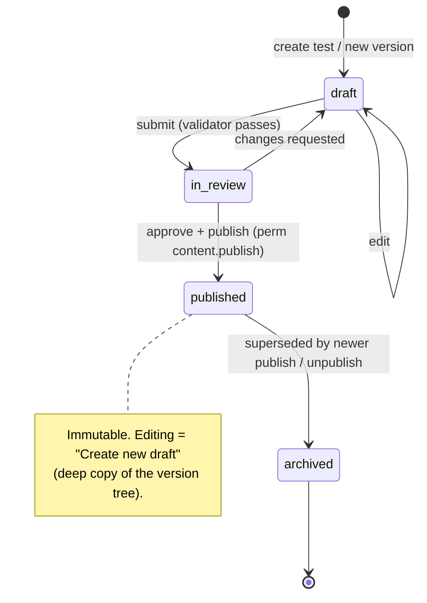
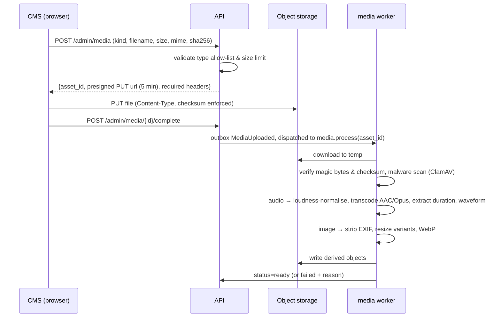
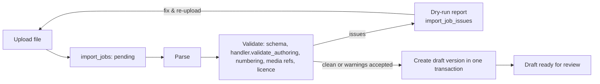

# IELTS MASTER 2.0 — Content Management Architecture

| Field | Value |
|---|---|
| Status | **Draft v0.2 — revised after Phase 1 audit; awaiting approval** |
| Related | `DATABASE_SCHEMA.md` §4, `QUESTION_BANK_DESIGN.md` |
| Last updated | 2026-11-17 |

---

## 1. Principles

1. **Everything is data.** Books, tests, questions, media, and band tables are created through the CMS or the import pipeline. No code change is ever needed to add content.
2. **Published content is immutable.** Students' historical attempts must always render and score against exactly what they saw (ADR-007).
3. **Licensing is enforced, not just recorded.** Content cannot be published without a valid licence record.
4. **Human-in-the-loop.** Automated imports and AI-assisted extraction produce *drafts*. Only a reviewer-approved version is ever published.
5. **Preview parity.** The CMS preview uses the same renderers as the student app.

## 2. Copyright & Licensing

| `source_type` | Meaning | Publish requirement |
|---|---|---|
| `original` | Authored in-house / commissioned | Contributor agreement reference |
| `licensed` | Third-party with written licence | Licence reference, validity dates, territory, permitted uses (e.g., "digital practice platform") |
| `public_domain` | Verified public domain / open licence | Source URL + licence (e.g., CC BY) and attribution text |
| `user_generated` | Student-submitted prompts (free practice) | Moderation; never shown to other users without consent |

Enforcement
- `books.license_id` and `media_assets.license_id` are required. The publish validator checks: licence exists, `valid_until` is null or in the future, and territory/uses are compatible.
- A daily beat job flags licences expiring within 30 days and can auto-unpublish content whose licence lapsed (configurable: warn vs unpublish). Students mid-attempt keep access until the attempt ends. Whether students may still **review** content of completed attempts after a licence lapses depends on licence terms (open decision D-14). The system supports all three options (keep review access / show scores only / remove) via a per-licence setting.
- The writing band descriptors used inside AI prompts are subject to D-16.
- Import tooling records provenance (file name, uploader, hash) per import job.
- **Engineering does not decide legality.** The licence record is entered by an Admin and is the business's attestation.

## 3. Content Lifecycle

Rules
- Only one `published` version per test (partial unique index). Publishing v(n+1) archives v(n) atomically in one transaction.
- `tests.current_published_version_id` is updated in the same transaction. Caches are invalidated via an outbox event.
- Archived versions stay readable by attempts that reference them, forever (or until retention policy).
- **Unpublish** (no successor) sets status `archived` and hides the test from the library. Attempts in progress may finish.
- Reviewers cannot approve their own versions (four-eyes principle; Super Admin can override with an audited reason).

### 3.1 Deep copy on "new draft"

A service routine copies the version tree (modules → sections → passages → paragraphs → groups → questions → options → keys → variants → explanations, writing tasks, speaking parts) in one transaction with new IDs, **preserving `questions.lineage_id`**. Media assets are referenced, not copied (they are immutable objects, and a replaced file is a new asset).

**Implementation status (2026-11-19):** the admin Listening editor (`ADMIN_CONSOLE.md` §8) uses this lifecycle, the deep copy and the four-eyes rule. No override is implemented: the author can never approve their own version (Product Owner decision, 2026-11-19). Drafts are edited by replacing the module tree through the import pipeline.

## 4. Roles in the CMS

| Action | Content Manager | Reviewer | Admin | Super Admin |
|---|---|---|---|---|
| Create/edit drafts | ✓ | – | ✓ | ✓ |
| Upload media | ✓ | – | ✓ | ✓ |
| Run imports | ✓ | – | ✓ | ✓ |
| Submit for review | ✓ | – | ✓ | ✓ |
| Approve / request changes | – | ✓ | ✓ | ✓ |
| Publish / unpublish | – | – | ✓ | ✓ |
| Manage licences | – | – | ✓ | ✓ |
| Delete draft | own | – | ✓ | ✓ |
| Hard-delete anything published | – | – | – | ✗ (never; archive) |

## 5. Media Pipeline

**Implementation status (2026-11-19, Listening management):** presigned PUT upload to S3-compatible storage (MinIO locally) and server-side verification on completion (existence, size, file signature, SHA-256) are implemented (`app/core/storage.py`, `app/modules/content/media.py`). **Not yet:** quarantine prefix + ClamAV scan, the media worker (transcode, loudness, duration, waveform), outbox dispatch and sweeper. Until those exist, uploads are allowed only in local/ci. Details: `ADMIN_CONSOLE.md` §8.3.

- Original uploads go to a `quarantine/` prefix and are promoted after the scan.
- Processing is dispatched through the outbox, and assets stuck in `processing` beyond the expected duration are re-dispatched by the maintenance sweeper (ADR-017).
- Student delivery uses short-lived signed GET URLs (exam audio: TTL ≈ section duration + margin), served through the CDN with signed URL/cookie support. Book covers for public pages can be public.
- Listening audio may optionally be segmented (`config.segments[{section, start_ms, end_ms}]`) for section-level practice without separate files.

## 6. Import Pipeline

### 6.1 Formats

- **JSON (canonical):** a full test-version tree matching the `TestVersionImport` Pydantic schema (published as JSON Schema in `docs/schemas/` when implemented). Lossless; used for round-trip export/import between environments.
- **CSV (question-level):** for bulk question entry into an existing group skeleton. Columns: `section_no, group_ref, question_type, number_from, number_to, stem, options, answer, variants, explanation, tags`. Multi-values are pipe-delimited. *Deferred from Phase 5a to the CMS (Phase 6): CSV edits an existing draft, which needs the editing UI and RBAC.*
- **Document-assisted (later, FR-CMS-08):** PDF/DOCX → text/layout extraction → LLM-assisted structuring into a JSON draft → **mandatory human review**. Clearly marked "machine-extracted" in the CMS until a reviewer verifies each group. Only for content with a valid licence.

### 6.2 Flow

- Import is **always dry-run first**. Commit requires an explicit second action.
- **Phase 5a implementation:** JSON import via `scripts/content_cli.py` (`import` → `import-commit`); JSON Schema at `docs/schemas/test-version-import.schema.json` (`content_cli.py export-schema`). Dry-run writes only `import_jobs` / `import_job_issues` (+ an audit row) and **no content rows** (tested). Commit rebuilds from the stored payload snapshot, upserts book/edition/test by natural key, and creates a **draft only**. The validator runs in two stages: `import` (malformed content = error, incomplete content such as missing Listening audio = warning) and `publish` (incomplete = error). Admin HTTP endpoints follow in Phase 5c (after RBAC).
- A test has at most one open (draft or in-review) version, enforced by a partial unique index and by the service.
- Imports are idempotent per `(job_id)`, and re-committing a job is rejected.
- Errors reference exact locations (`section 2 › group 3 › question 14: answer exceeds word_limit=2`).

## 7. Publish Validator (gate)

A version cannot move to `in_review` or `published` unless:
1. Structure: required modules/sections exist per module type (Listening 4 sections, Reading 3 passages for Academic, etc.; GT reading structure validated separately).
2. Numbering: contiguous, unique question numbers per module (Listening 1–40, Reading 1–40).
3. Every question has a valid key per its handler. Every group config validates.
4. All referenced media `ready`, and licences valid.
5. Explanations present (warning, not blocking, configurable).
6. Band conversion table available for module/variant.
7. Rich text sanitised (allow-listed ProseMirror node types only).

## 8. Caching of Published Content

Published version trees are immutable, so they cache perfectly:
- Key `content:tv:{test_version_id}:student_view:{mode}`. **No TTL needed** (invalidation by version id change), with LRU eviction in Redis.
- Library listings: `content:library:{filters_hash}` with short TTL (5 min) + event-based invalidation on publish.
- Next.js public pages use ISR with on-demand revalidation triggered by the publish event (webhook to a Next.js revalidate route with a secret).

## 9. Audit

Every create/update/delete/submit/approve/publish writes `audit_logs` with a redacted before/after diff, actor, and request ID. The CMS shows a per-version history timeline.
