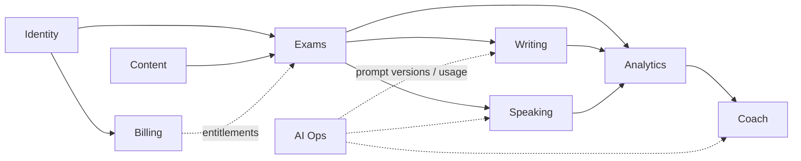
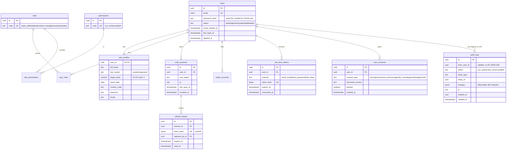
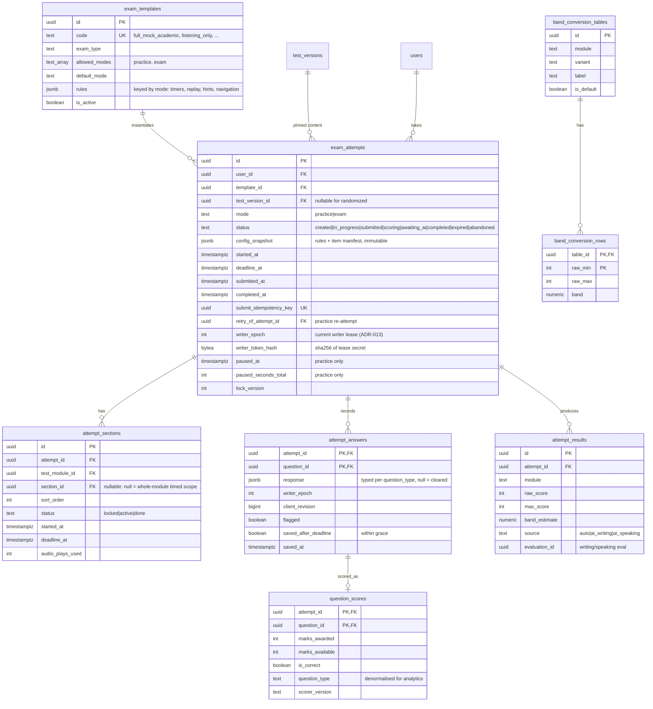
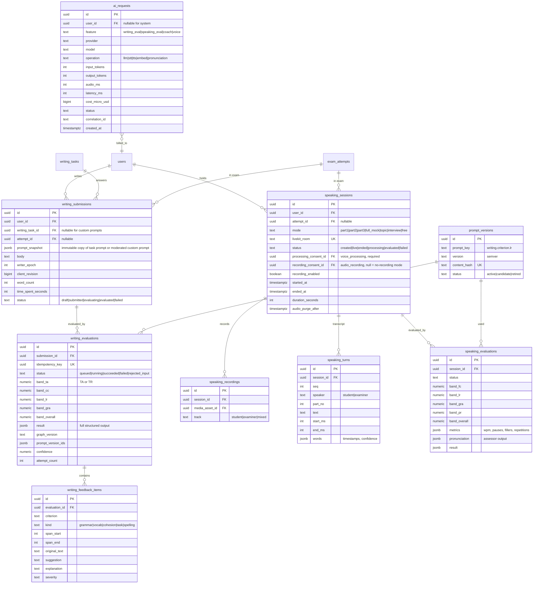
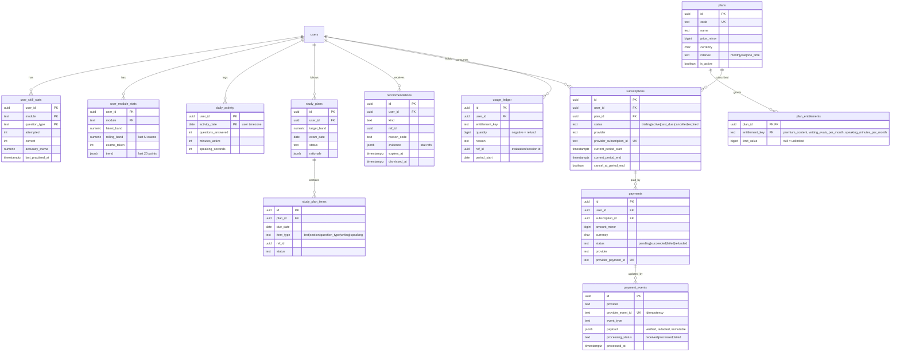

# IELTS MASTER 2.0 — Database Schema

| Field | Value |
|---|---|
| Status | **Draft v0.2 — revised after Phase 1 audit; logical design, awaiting approval** |
| Engine | PostgreSQL 17+ (18 preferred), extensions: `vector` (pgvector), `pg_trgm`, `citext` |
| Engine clarification (Phase 3, 2026-11-17) | Local development runs **PostgreSQL 18.2 + pgvector 0.8.1** (`pgvector/pgvector:0.8.1-pg18-trixie`), within the approved "17+, 18 preferred". The production managed version is chosen with D-05 and must offer pgvector ≥ 0.8 and the same major version as local/CI. The app uses no 18-only feature: PostgreSQL 18's built-in `uuidv7()` is deliberately **not** used, because IDs are generated in the application (ADR-012, Python 3.14 `uuid.uuid7()`), which keeps 17 compatible. `pgcrypto` (listed in v0.1/v0.2) is **not required**: `gen_random_uuid()` is built in since PostgreSQL 13 and IDs are app-generated. It is added only if a later feature needs it. |
| ORM / migrations | SQLAlchemy 2.x (2.0-style API; locked at 2.1.9, constrained `>=2.0,<2.2`), async via asyncpg, typed `Mapped[]`; Alembic 1.20 |
| Implemented (Phase 3) | `backend/app/core/orm.py` (Base, naming convention, mixins), `backend/app/core/database.py` (engine, sessions), `backend/app/shared/ids.py` (UUIDv7), `backend/migrations/` (Alembic) |
| Last updated | 2026-11-17 |

This is the logical schema. Physical details (exact column types, partial indexes) get finalised in the migration PRs of each phase. Changes to this document and the migrations ship together.

---

## 1. Conventions

| Topic | Rule |
|---|---|
| Naming | `snake_case`, plural table names, `<singular>_id` FKs |
| Primary keys | `id uuid` (UUIDv7 generated in app) |
| Timestamps | `created_at`, `updated_at timestamptz NOT NULL DEFAULT now()`; `updated_at` maintained by app |
| Enums | PostgreSQL `text` + `CHECK` constraint (easier migrations than native enums), mirrored by Python `StrEnum` |
| Soft delete | Only where justified (users — for legal retention window; content — never deleted once attempted, archived instead). Column `deleted_at timestamptz NULL` + partial indexes `WHERE deleted_at IS NULL` |
| Delete behaviour | `ON DELETE CASCADE` only inside an aggregate (e.g., question → options). `RESTRICT` across aggregates (e.g., attempts → test_versions). `SET NULL` for optional references (e.g., audit actor) |
| JSONB | Only for: per-question-type config validated by Pydantic, immutable snapshots, provider metadata, AI structured output archives. Never for data we filter/join on regularly |
| Money | `amount_minor bigint` + `currency char(3)` |
| Multi-tenancy | Not now; `organization_id` can be added later to users/content without restructuring |
| Constraint naming | Naming convention set on `Base.metadata`: `pk_<table>`, `fk_<table>_<column>_<referred_table>`, `uq_<table>_<columns>`, `ix_<table>_<column>`, `ck_<table>_<name>` (CHECK constraints need an explicit `name=`). PostgreSQL 18 also records NOT NULL constraints in `pg_constraint` with system names (`<table>_<column>_not_null`). These are expected and outside the convention |
| Timestamp maintenance | `TimestampMixin`: both columns `DEFAULT now()` (database clock, transaction time). `updated_at` is refreshed by the ORM on every UPDATE it emits (`onupdate`). Bulk Core `update()` statements must set it explicitly |
| Engine & sessions | One pooled `AsyncEngine` per process (`pool_pre_ping`, size/overflow/timeout/recycle/connect-timeout from `DB_*` settings, `application_name=ielts-backend`). One `AsyncSession` per request (`get_db_session`, `expire_on_commit=False`). Services own the transaction (`async with session.begin()`); an uncommitted session is rolled back |

---

## 2. Domain Overview

---

## 3. Identity & Access

**Implementation status (2026-11-18; migrations `0006` identity + RBAC seed, `0007` outbox):** implemented `users` (password_hash NOT NULL until social login, D-06), `user_profiles` (full_name only so far), `roles`, `permissions`, `role_permissions`, `user_roles` (+ `granted_by`), `auth_sessions`, `one_time_tokens`, `user_consents` (+ `age_confirmation` type) and `outbox_messages`. **Changed:** opaque server-side sessions (ADR-006 revised): `auth_sessions` holds `token_hash`, `idle_expires_at`, `absolute_expires_at`, `revoked_reason` and a truncated `ip_prefix` (/24, /48) instead of a full IP; **`refresh_tokens` is not created**. Seeded roles and permissions follow SECURITY_GUIDELINES.md §4.1 plus `admin.access` for all staff roles. Downgrades refuse to drop the identity schema while user accounts exist, or the outbox while undelivered messages exist. **Not yet:** `oauth_accounts` (D-06), `user_mfa_factors` (staff 2FA stage), the other profile fields, and foreign keys from content actor columns to `users`.

Notes
- `auth_sessions` rows are deleted 30 days after revocation/expiry and spent `one_time_tokens` 7 days after use/expiry (outbox worker cleanup).
- `audit_logs` is append-only: the app DB role has `INSERT, SELECT` only on it. `actor_user_id` is a plain UUID with no FK (ADR-016), so deleting a user requires no UPDATE on the log. It is partitioned monthly once volume justifies it.
- **Account deletion states:** `active → deleted` (user-initiated; `deleted_at` set, login disabled, sessions revoked) → after the 14-day grace a purge job hard-deletes `users`, `user_profiles`, sessions, tokens, consents, and all owned student data (CASCADE within the user's aggregates), and deletes owned objects in storage. Rows that must outlive the user for legal/accounting reasons (`payments`, `ai_requests`, `audit_logs`) keep only the UUID or have `user_id` set NULL, so they become pseudonymous. Reactivation is possible only during the grace period.
- MFA secrets (`user_mfa_factors`) are stored encrypted with an application-level key (envelope encryption).

---

## 4. Learning Content

The core hierarchy separates **logical identity** (book, test) from **versioned content** (test_version and everything under it). This is ADR-007.

```mermaid
erDiagram
    content_licenses ||--o{ books : covers
    books ||--o{ book_editions : has
    book_editions ||--o{ tests : contains
    tests ||--o{ test_versions : versioned_as
    test_versions ||--o{ test_modules : has
    test_modules ||--o{ sections : has
    sections ||--o{ passages : has
    passages ||--o{ paragraphs : has
    sections ||--o{ question_groups : has
    question_groups ||--o{ questions : has
    questions ||--o{ question_options : has
    question_groups ||--o{ question_options : "shared options"
    questions ||--o{ answer_keys : has
    answer_keys ||--o{ answer_variants : accepts
    questions ||--o| explanations : explained_by
    test_modules ||--o{ writing_tasks : has
    test_modules ||--o{ speaking_parts : has
    speaking_parts ||--o{ speaking_questions : has
    media_assets ||--o{ sections : "audio"
    test_versions ||--o{ content_reviews : reviewed_in

    content_licenses {
        uuid id PK
        text source_type "original|licensed|public_domain|user_generated"
        text licensor
        text licence_reference
        date valid_from
        date valid_until
        jsonb terms "territories, permitted uses"
    }
    books {
        uuid id PK
        text slug UK
        text title
        text series
        text category
        uuid license_id FK
        uuid cover_asset_id FK
        tsvector search_vector
        boolean is_premium
        timestamptz deleted_at
    }
    book_editions {
        uuid id PK
        uuid book_id FK
        text edition_label
        int publication_year
        text variant "academic|general|both"
        int sort_order
    }
    tests {
        uuid id PK
        uuid edition_id FK
        text code "e.g. T2"
        text title
        int sort_order
        uuid current_published_version_id FK
    }
    test_versions {
        uuid id PK
        uuid test_id FK
        int version_no
        text status "draft|in_review|published|archived"
        uuid created_by FK
        timestamptz published_at
        uuid published_by FK
        text change_note
    }
    test_modules {
        uuid id PK
        uuid test_version_id FK
        text module "listening|reading|writing|speaking"
        text variant "academic|general|common"
        int duration_seconds
        int sort_order
    }
    sections {
        uuid id PK
        uuid test_module_id FK
        int section_no
        text title
        text instructions
        uuid audio_asset_id FK "listening"
        int duration_seconds "nullable"
    }
    passages {
        uuid id PK
        uuid section_id FK
        text title
        text body_format "prosemirror_json|markdown"
        jsonb body "sanitised rich text"
        int word_count
    }
    paragraphs {
        uuid id PK
        uuid passage_id FK
        text label "A, B, C"
        int sort_order
        text plain_text
    }
    question_groups {
        uuid id PK
        uuid section_id FK
        text question_type
        text instructions
        jsonb config "type-specific, validated"
        uuid image_asset_id FK
        int sort_order
    }
    questions {
        uuid id PK
        uuid group_id FK
        uuid lineage_id "stable across versions"
        int number_from
        int number_to
        int marks
        jsonb stem "prompt text / blank template"
        jsonb config
        text difficulty
        text_array tags
    }
    question_options {
        uuid id PK
        uuid question_id FK "nullable"
        uuid group_id FK "nullable (shared list)"
        text label "A, i, etc."
        text text
        int sort_order
    }
    answer_keys {
        uuid id PK
        uuid question_id FK
        int slot "1..marks, multi-mark questions only"
        text canonical_value
        text match_mode "text|option|set_member|numeric|time|date"
    }
    answer_variants {
        uuid id PK
        uuid answer_key_id FK
        text value
    }
    explanations {
        uuid id PK
        uuid question_id FK,UK
        jsonb body
        uuid evidence_paragraph_id FK
        int audio_start_ms
        int audio_end_ms
    }
    writing_tasks {
        uuid id PK
        uuid test_module_id FK
        int task_no "1|2"
        text task_kind "academic_report|gt_letter|essay"
        jsonb prompt
        uuid image_asset_id FK
        int min_words
        jsonb key_features "Task 1 expected features"
    }
    speaking_parts {
        uuid id PK
        uuid test_module_id FK
        int part_no "1|2|3"
        text topic
        jsonb cue_card "part 2"
    }
    speaking_questions {
        uuid id PK
        uuid speaking_part_id FK
        text text
        int sort_order
        boolean is_follow_up
    }
    media_assets {
        uuid id PK
        text kind "audio|image|document"
        text storage_key UK
        text mime_type
        bigint size_bytes
        int duration_ms
        text checksum_sha256
        text status "uploading|processing|ready|failed"
        uuid license_id FK
    }
    content_reviews {
        uuid id PK
        uuid test_version_id FK
        uuid reviewer_id FK
        text decision "approved|changes_requested"
        text comment
    }
```

Supporting tables (not drawn): `question_types` (reference table: `code` PK, `modules`, `handler_version`, `is_active`; `question_groups.question_type` references it), `content_tags`, `speaking_topics` (standalone topic bank for free practice, not tied to a test), `import_jobs` + `import_job_issues`, `content_chunks` (RAG embeddings, §8), `band_conversion_tables` + `band_conversion_rows`, `sample_answers` (`id, writing_task_id | speaking_part_id, band, body, license_id NOT NULL, author_note`; shown only where the licence permits, FR-WR / brief §4 "sample answers where licensed").

**Implementation status (Phase 5a, migrations 0002–0005, 2026-11-18).** `0002` audit_logs · `0003` content schema (autogenerated, then reviewed) · `0004` seeds the 18 question types · `0005` immutability triggers. Planned as six migrations; consolidated into four because the content tables form one reviewed unit. Differences from the logical model above:
- Added: `answer_keys.notation` (authored key notation kept for review/export), `test_versions.submitted_at`, partial unique index `uq_test_versions_one_open` (one draft/in-review version per test), `content_licenses.post_lapse_access` (**nullable**, no default until D-14), `media_assets.license_id NOT NULL`, `import_jobs.payload` (immutable JSONB snapshot of the validated file).
- `questions` CHECK `marks = number_to - number_from + 1` (one mark per question number).
- Actor columns (`created_by`, `published_by`, `reviewer_id`, `uploaded_by`) are plain UUIDs; FKs to `users` arrive with Phase 3b.
- Deferred (not needed yet): `speaking_topics`, `content_tags` (tags live in `questions.tags`), `content_chunks` (Phase 8/11).
- `band_conversion_tables` / `_rows`: structure only, **no values seeded** until a source is approved; the validator reports `band_table_missing` as a warning.
- Safety: downgrading below `0004` fails while content references the seeded question types (FK RESTRICT), so a downgrade cannot silently destroy content (tested).

**Migration 0008 (2026-11-19, authoring metadata):** nullable `test_versions.description`, `difficulty` (`easy|medium|hard`, CHECK) and `tags text[]`; `tests.admin_notes` (internal); `sections.context`; `media_assets.original_filename` and `uploaded_by`. The `test_versions` guard trigger now also freezes `description`, `difficulty` and `tags` outside draft. No new tables.

**Why `media_assets` instead of `audio_assets` + `image_assets`:** both have identical lifecycle (upload → scan → process → ready), storage, and access rules. Kind-specific fields (duration) are nullable. One table keeps one upload pipeline.

**Why `writing_prompts` → `writing_tasks`:** the entity is the task inside a test (task number, minimum words, chart). Standalone practice prompts reuse the same table with `test_module_id` nullable plus a `source` column.

Key constraints
- `uq_test_versions_test_id_version_no`.
- Partial unique index: at most one `published` version per test (`WHERE status = 'published'`).
- `uq_test_modules_version_module_variant`.
- `questions.number_from <= number_to`. Question numbers are unique per `test_module` (enforced at publish by the validator, since uniqueness spans groups).
- A published version is immutable: enforced in the service layer **and** by triggers on the child tables (modules → explanations) that reject INSERT/UPDATE/DELETE on rows whose owning `test_version.status IN ('published','archived')` (defence in depth). On `test_versions` itself, the trigger allows only the lifecycle columns to change (`status`, `published_at`, `published_by`) and only along legal transitions (`in_review → published`, `published → archived`).
- `question_options`: `CHECK (num_nonnulls(question_id, group_id) = 1)`, so each option belongs to exactly one question or one shared group list.
- `answer_keys`: `slot` is unique per question, and `count(slots) = questions.marks` is validated at publish time.
- `tests.current_published_version_id → test_versions` and `test_versions.test_id → tests` form an intentional FK cycle. The former is nullable and set only in the publish transaction (`DEFERRABLE INITIALLY DEFERRED` is not required because the version row exists before the pointer is set).

---

## 5. Examinations

**Implementation status (2026-11-19, migration `0009`):** created `exam_templates` (seed `listening_only`), `exam_attempts` (+ `test_id`, `submitted_by`, `create_idempotency_key` unique per user, `submit_idempotency_key` unique; partial unique index one open exam-mode attempt per user/template/version; partial index on running deadlines for the sweeper; no `paused_*`, `retry_of_attempt_id`, `lock_version` yet), `attempt_sections` (PK attempt+section, `audio_plays_used`, `audio_started_at`; no per-section deadlines: Listening is timed per module), `attempt_answers`, `question_scores` (+ `section_no`, `reason`), `attempt_results` (+ `band_table_id`, `created_at`). Users → attempts `ON DELETE CASCADE`; content references `RESTRICT`. Downgrade refuses while attempts exist.

Notes
- `attempt_answers` uses a composite PK `(attempt_id, question_id)`, which makes autosave a natural UPSERT. Idempotency and stale-write protection come from `WHERE (excluded.writer_epoch, excluded.client_revision) > (attempt_answers.writer_epoch, attempt_answers.client_revision)` (row comparison), executed while holding `FOR SHARE` on the attempt row (ADR-013).
- `attempt_sections`: `CHECK` that `section_id`, when set, belongs to `test_module_id` (validated in service; FK to both).
- Open-attempt uniqueness: partial unique indexes as defined in `EXAMINATION_ENGINE_DESIGN.md` §9.
- `config_snapshot` is intentionally JSONB: it is an immutable record of exactly which items and rules applied to this attempt (essential for randomized/custom exams), and it is never queried relationally.
- `attempt_answers` and `question_scores` are the highest-volume tables. They get declarative range partitioning on attempt creation month once there are more than ~50M rows (UUIDv7 makes range partitioning on id feasible).
- Unique partial index: one `in_progress` exam-mode attempt per (user, template, test_version) prevents duplicate parallel attempts.

---

## 6. AI: Writing, Speaking, Ops

> **Implemented 2026-11-19 (migration 0011), simplified:** `rubric_versions` + `rubric_reviews` (four-eyes; criteria immutable out of draft by trigger; one published per module), `writing_submissions` (one draft per user+task, immutable once submitted by trigger, `client_revision` guard), `writing_evaluations` and `speaking_evaluations` (one row per run, unique `idempotency_key`, half-step band checks, `rubric_version_id`, prompt version/hash), `speaking_sessions` (required `processing_consent_id` / `recording_consent_id`, `audio_purge_after`), `speaking_recordings` (private object key, size, SHA-256, duration, transcript). `sample_answers` (model answers) join the content immutability guard. Not yet: `writing_feedback_items` (feedback lives in `result` JSON), `speaking_turns`, `prompt_versions`, `ai_requests`, LiveKit rooms, the audio purge job.

> **Migration 0012 (AI Speaking Room):** `examiner_profiles` (3 seeded placeholders, empty `voice`), `examiner_configs` (published rows read-only by trigger), `speaking_turns` (unique `(session_id, seq)`), and room columns on `speaking_sessions` (`kind`, `room_code`, `examiner_id`, `examiner_config_id`, `config_snapshot`, `conduct_mode`, `current_step`, `started_at`, `ended_at`, `duration_seconds`, `completion_reason`; statuses `created`, `live`, `completed`). No `livekit_room` column yet: `room_code` is provider-independent.

Supporting: `evaluation_datasets`, `evaluation_examples` (human-scored benchmark items), `evaluation_runs` (offline eval runs with metrics, tied to prompt/graph versions), `provider_routes` (feature → provider/model priority list).

Notes
- `speaking_turns`: unique `(session_id, seq)`, which makes the voice engine's batched turn posts idempotent.
- `writing_submissions.prompt_snapshot` makes every evaluation reproducible even if a standalone practice task is later edited (standalone tasks are not part of versioned test trees).
- `ai_requests.user_id` uses `ON DELETE SET NULL` (pseudonymised on account purge). Unlike `audit_logs`, this is an operational metrics table, and the app role has normal DML on it.
- Prompt **text** lives in the repo (`ai-engine/ielts_ai/prompts/`) for code review. `prompt_versions` registers the hash and version that was active so every evaluation is reproducible.
- Speaking transcripts are relational (`speaking_turns`) because they are queried for review UI and filler analysis. Word-level timing is JSONB (dense, read as a whole).
- `ai_requests` is partitioned monthly. Raw prompts/responses are **not** stored here (PII), only metrics. Full traces go to LangSmith with redaction, under a retention policy.

---

## 7. Analytics, Coach, Billing, Notifications

Supporting: `notifications`, `notification_preferences`, `feature_flags`, `outbox_events`, `processed_events` (consumer dedupe by `event_id`), `system_settings`, `item_stats` (per `lineage_id`: p-value, discrimination, median time — content QA), `platform_daily_metrics` (admin rollups), `attempt_answer_checks` (practice-mode "check answer" events, excluded from accuracy), `coach_conversations` + `coach_messages` (retention-limited).

**Subscriptions:** partial unique index `(user_id) WHERE status IN ('trialing','active','past_due')`, so a user has at most one live subscription. Users without one get the implicit `free` plan's entitlements. Before payments exist (Phase 8–11), Admins assign plans via `subscriptions.provider = 'manual'`.

**Usage enforcement.** `usage_ledger` is the authoritative record, with a unique `(entitlement_key, ref_id)` so a retried task can't double-charge. Redis holds a hot counter per (user, key, period) for fast pre-checks, rebuilt from the ledger on cache miss. Reservation pattern: reserve (+1) before the AI call, refund (−1) if the evaluation fails for system reasons.

---

## 8. Vector Search (pgvector)

`content_chunks(id, source_type, source_id, chunk_index, text, embedding vector(N), embedding_model, metadata jsonb)`, with an HNSW index (`vector_cosine_ops`).
Used for: (1) coach RAG over **authorised** learning resources (strategy guides, rubric descriptors, licensed explanations), (2) "similar questions" recommendations. It is not used for exact lookups. `embedding_model` is stored per row so models can migrate by re-embedding in the background. N is fixed per model, and a model change uses a new column/table.

---

## 9. Indexing Plan (initial)

| Table | Index | Purpose |
|---|---|---|
| books | GIN(`search_vector`), GIN trigram(title) | search |
| tests | (edition_id, sort_order) | listing |
| test_versions | partial unique (test_id) WHERE published | one published |
| questions | (group_id, number_from); (lineage_id) | render; analytics |
| exam_attempts | (user_id, created_at DESC); partial (status) WHERE status IN ('in_progress','scoring','awaiting_ai'); (deadline_at) WHERE in_progress | history; sweeps |
| attempt_answers | PK | autosave |
| question_scores | (question_id) | item statistics |
| writing_submissions | (user_id, created_at DESC) | history |
| ai_requests | (user_id, created_at), (feature, created_at) | cost dashboards |
| audit_logs | (entity_type, entity_id, created_at), (actor_user_id, created_at) | inspection |
| usage_ledger | (user_id, entitlement_key, period_start); unique (entitlement_key, ref_id) | quotas |
| outbox_events | partial (created_at) WHERE published_at IS NULL | dispatcher |

---

## 10. Migration Strategy

1. **Single linear Alembic history** in `backend/migrations`. Branching migrations are rejected in CI (`alembic heads` must equal 1, plus a test that every revision is a 4-digit sequential ID and none is a merge point).
   - Revision IDs are sequential: `0001`, `0002`, … (`alembic revision -m "<slug>" --rev-id 0002`). Files are named `<YYYYMMDD>_<rev>_<slug>.py`. A rebase conflict on the same number is resolved by renumbering before merge.
   - `0001` enables `citext`, `pg_trgm`, `vector` (`IF NOT EXISTS`). The migrating role must be allowed to create them (superuser locally; provider allow-list on managed PostgreSQL).
   - **Extension ownership (decided 2026-11-17, option B):** extensions are database infrastructure, not app-owned schema, and may be pre-installed by an administrator. Migrations create them idempotently but **never drop them on downgrade**: `0001`'s downgrade is a documented no-op. Removing an extension is a manual admin operation. Option C (provisioning creates extensions; the migration only checks they exist) is revisited with D-05.
   - The URL comes from `DATABASE_URL` (`DatabaseSettings`). Nothing is stored in `alembic.ini`.
   - Locally and in deployments, migrations run as a **separate one-off job** (`migrate` service in Compose, same backend image) before the API starts.
2. Every migration is reviewed by the DB owner and must include a `downgrade()` or an explicit note why it is irreversible.
3. **Expand → migrate → contract** for any breaking change: add new column/table (deploy), backfill via batched job, switch reads/writes (deploy), drop old (separate later release, needs explicit approval).
4. No destructive operation (DROP, column type narrowing, data delete) without explicit approval in the PR (label `db-destructive`).
5. Long index creation uses `CREATE INDEX CONCURRENTLY` (in an autocommit migration block).
6. CI runs `upgrade head → downgrade -1 → upgrade head` against a fresh Postgres, plus model/migration drift detection (`alembic check`).
7. Seed data: reference data (roles, permissions, question type registry, default band tables, plans) seeded by idempotent migrations. **Demo/mock content is dev-only** and lives in `scripts/seed_dev/`, guarded so it can never run against production.

---

## 11. Database Roles & Access

| Role | Privileges |
|---|---|
| `ielts_migrator` | DDL; used only by the migration job |
| `ielts_app` | DML on app tables; INSERT/SELECT only on `audit_logs`; INSERT/SELECT plus column-level `UPDATE (processed_at, processing_status, error)` on `payment_events` (payload immutable) |
| `ielts_readonly` | SELECT on non-PII views for analytics/BI |
| `ielts_voice` | none (voice engine has no DB access — ADR-004) |

Connections: async `asyncpg` pool per process, PgBouncer in transaction mode in production (`prepared_statement_cache_size=0` configured accordingly).
Backups: managed PITR (≥ 7 days) + daily logical dumps to separate-account object storage (30 days), restore drill monthly.
