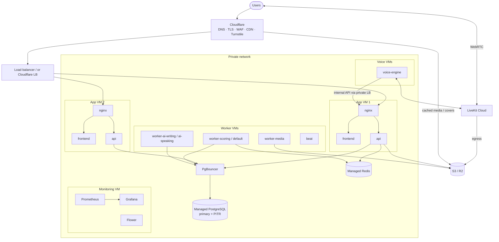

# IELTS MASTER 2.0 — Deployment Architecture

| Field | Value |
|---|---|
| Status | **Draft v0.2 — revised after Phase 1 audit; awaiting approval** |
| Approach | Docker images + Docker Compose on VMs, managed data services, no Kubernetes initially (ADR-009) |
| Open decisions | D-05 hosting provider · D-02 LiveKit Cloud vs self-host |
| Last updated | 2026-11-17 |

---

## 1. Runtime Inventory

| Runtime | Image | Scales by | Health |
|---|---|---|---|
| `frontend` | Next.js standalone output (Node) | replicas | `/healthz` (Next route handler; not under `/api/*`, which Nginx routes to FastAPI per ADR-006) |
| `api` | backend (`uvicorn app.main:create_app --factory`) | replicas | `/healthz`, `/readyz` |
| `worker-default`, `worker-scoring`, `worker-ai-writing`, `worker-ai-speaking`, `worker-media`, `worker-maintenance` | backend image, `celery -A app.workers worker -Q <queue>` | per-queue replicas & concurrency | Celery inspect ping + heartbeat metric |
| `beat` | backend image, `celery beat` | **exactly one**: a single replica pinned to the worker VM by Compose (Celery beat has no built-in leader election). If HA is needed later, switch to a lock-based scheduler such as RedBeat (a new dependency needing approval). Beat jobs are idempotent, so a brief double run during a deploy is harmless | heartbeat |
| `flower` | flower | 1, internal only behind auth | — |
| `voice-engine` | voice-engine image | replicas (LiveKit dispatch) | agent worker health endpoint |
| `nginx` | nginx | 1 per app VM | — |
| `migrate` | backend image, `alembic upgrade head` | one-off job per deploy | exit code |

Managed services: PostgreSQL (with PITR) + PgBouncer, Redis (with persistence for broker durability; **local development deliberately runs Redis with persistence disabled**, `--save "" --appendonly no` in `docker-compose.yml`, because Redis is never the source of truth and local queues are disposable), S3/R2, LiveKit Cloud (recommended), email provider, Sentry, LangSmith. Prometheus + Grafana run self-hosted on a monitoring VM or Grafana Cloud.

## 2. Production Topology (initial)

- Two app VMs for zero-downtime rolling deploys. Workers and voice on separate VMs so CPU-heavy media processing and real-time audio never contend with request handling.
- Only Cloudflare IP ranges may reach the public load balancer/Nginx (firewall rule). The DB and Redis have no public endpoints.
- `/internal/*` routes are served only on the private listener (separate Nginx server block bound to the private interface).

## 3. Environments

| Env | Hosting | Deploy trigger | Notes |
|---|---|---|---|
| local | Docker Compose (Phase 2: postgres, redis, backend, frontend; further services added per phase, see `DEVELOPMENT_GUIDELINES.md` §1) | `docker compose up` | hot reload |
| staging | smaller copy of prod (1 app VM, 1 worker VM, LiveKit Cloud dev project) | merge to `main` | prod-like config, synthetic data |
| production | as above | manual approval of a tagged release | |

## 4. CI/CD Pipeline (GitHub Actions)

```mermaid
flowchart LR
    PR[Pull request] --> L[lint · types · boundaries]
    L --> T[unit + integration tests<br/>postgres/redis services]
    T --> C[contract: OpenAPI → TS client drift]
    C --> M[migration check:<br/>single head · up/down/up]
    M --> S[security: gitleaks · pip-audit · pnpm audit · semgrep]
    S --> AI["AI regression, fixture mode"]
    AI --> OK{all green}
    OK --> MERGE[squash merge to main]
    MERGE --> BUILD[build images · SBOM · Trivy scan · sign]
    BUILD --> REG[(container registry<br/>tag = git sha)]
    REG --> STG[deploy staging<br/>migrate → rolling restart]
    STG --> E2E[Playwright e2e · ZAP baseline · smoke]
    E2E --> TAG[release tag vX.Y.Z]
    TAG --> APPROVE{manual approval}
    APPROVE --> PROD[deploy production]
    PROD --> SMOKE[smoke tests · error-rate watch 15 min]
    SMOKE -->|regression| RB[rollback to previous sha]
```

Deploy mechanics (per VM, via SSH from Actions using OIDC-fetched short-lived credentials or a pull-based agent):
1. `docker compose pull` (image tags pinned to the release sha).
2. Run the `migrate` job once (migrations must be backward-compatible with the previous release: expand/contract).
3. Rolling restart: drain a VM from the LB → `docker compose up -d` → health check → re-enable → next VM.
4. Workers: graceful shutdown (`SIGTERM`, Celery warm shutdown, `acks_late` ensures no lost tasks).
5. Voice engine: drain mode, so existing sessions finish (up to 20 min) while new jobs go to new workers.

Rollback = redeploy the previous image sha (DB stays forward-compatible thanks to expand/contract).

## 5. Configuration & Secrets

- Twelve-factor env configuration, validated at startup (the app refuses to boot on missing/invalid config).
- Secrets come from the secret manager into env files on hosts with `0600` permissions, owned by the deploy user, and never baked into images.
- Per-environment provider API keys with spend caps.

## 6. Observability

| Signal | Tooling | Key dashboards / alerts |
|---|---|---|
| Metrics | Prometheus (API, workers via exporter, voice, Postgres exporter, Redis exporter, node exporter) | API RED metrics, autosave p95, queue depth & age per queue, task failure rate, voice turn latency p95, DB connections/locks/replication, AI cost/hour |
| Logs | JSON to stdout → Loki (or provider log service) | error search by request_id |
| Errors | Sentry (frontend, backend, workers, voice) | new issue alerts, release health |
| Traces | OpenTelemetry → Tempo/Jaeger (optional Phase 12), LangSmith for LLM graphs | |
| Uptime | external checker (health endpoints + synthetic login) | |

Alert routing: P1 (site down, DB down, autosave error rate > 1%, queue age > 5 min on scoring) → immediate page. P2 → chat channel.

## 7. Backup & Disaster Recovery

- PostgreSQL: managed PITR (≥ 7 days) + nightly logical dump → separate-account bucket (30 days, encrypted). **Monthly restore drill** into an isolated instance, with verification queries.
- Object storage: versioning on content/media buckets, cross-region replication for content (recordings excluded, governed by retention).
- Redis: not a durable store. Loss means re-queuing via outbox (pending events re-dispatched) and cache rebuild.
- RPO ≤ 15 min, RTO ≤ 4 h (NFR-RL-03). DR runbook in `docs/runbooks/` (Phase 13).

## 8. Capacity Baseline (to validate with k6 in Phase 12)

| Component | Starting size |
|---|---|
| App VMs | 2 × 4 vCPU / 8 GB (api 4 workers + frontend) |
| Worker VM | 1 × 8 vCPU / 16 GB (split queues via concurrency) |
| Voice VM | 1 × 4 vCPU / 8 GB (~20–40 sessions) |
| PostgreSQL | 4 vCPU / 16 GB, 200 GB SSD, PgBouncer pool 100 |
| Redis | 2–4 GB, persistence AOF everysec |

## 9. Future Evolution

Kubernetes/ECS is introduced when one of these holds: more than ~3 VM roles need autoscaling, multi-region is required, or deploy coordination becomes a bottleneck. Images, health checks, and twelve-factor config are already compatible, so the move is mostly mechanical.
