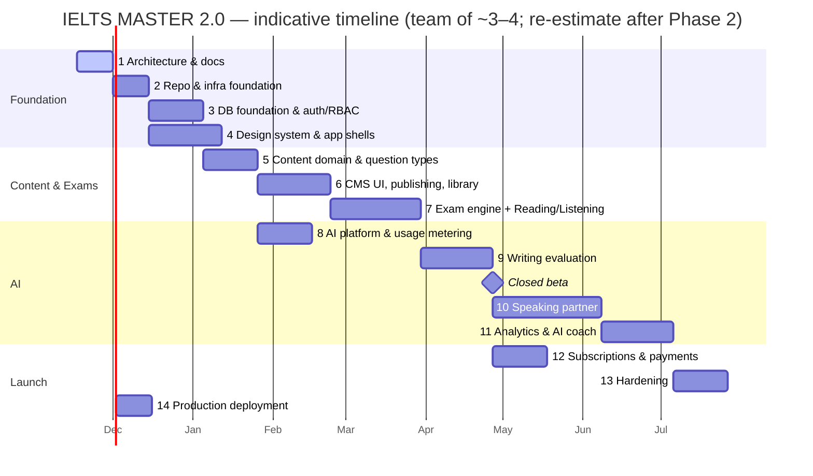
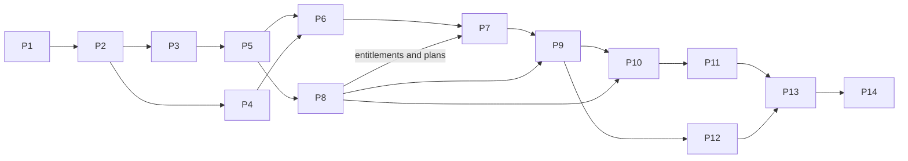

# IELTS MASTER 2.0 — Development Roadmap

| Field | Value |
|---|---|
| Status | **Draft v0.2 — revised after Phase 1 audit; awaiting approval** |
| Rule | A phase starts only after the previous phase is reviewed and approved. Within a phase, work is split into small reviewed tasks |
| Last updated | 2026-11-17 |

---

## 1. Refinements to the Proposed Order

| Change | Reason |
|---|---|
| Split "CMS & Library" into **5 (content domain + question-type registry + JSON import, backend)** and **6 (CMS UI + publishing + student library)** | The question-type registry is the foundation for CMS, rendering, and the exam engine. It must be stable before UI is built on it |
| "Question Bank & Exam Engine" + "Reading & Listening" merged into **7** | Reading/Listening *are* the first consumers of the exam engine. Building the engine without them yields an untested abstraction |
| New **8: AI platform & usage metering** before Writing | Provider abstraction, cost logging, quotas, and entitlements must exist **before** any AI feature goes live, or costs are uncontrolled |
| Payments (12) stays late, but **entitlements** land in 8 | Features can be gated by plan (manually assigned) without the payment integration |
| Security & performance are continuous, with a dedicated hardening phase **13** before launch | Security review is part of every phase's acceptance criteria |
| **Beta milestone** after Phase 9 | Library + exams + writing evaluation is a viable product for a closed beta. Real usage informs speaking and coach work |

## 2. Phase Overview

Durations are indicative only and will be re-estimated at the end of Phase 2, once team size is known. Phases 4 and 8 can run in parallel with backend work given separate owners.

Phase 7 enforces plan entitlements (`ent:` checks on attempt creation, premium content, FR-LIB-07), so the **entitlements/plans/usage-ledger part of Phase 8 must be complete before Phase 7 closes**. Phase 8 starts after Phase 5 and runs in parallel with Phase 6, with entitlements delivered first.

---

## 3. Phase Details

### Phase 1 — Architecture & Documentation *(current)*
- **Objectives:** a sound, reviewed foundation. No application code.
- **Deliverables:** 15 documents in `docs/`, Mermaid diagrams, ADRs, open-decision register.
- **Dependencies:** none.
- **Acceptance:** Product Owner approves the architecture. Open decisions D-01…D-16 answered or explicitly deferred with an owner and a blocking phase.
- **Testing:** n/a (doc consistency review).
- **Risks:** analysis paralysis → timebox revisions to one round of feedback.
- **Checklist:** ☑ docs drafted · ☐ reviewed · ☐ decisions answered · ☐ approved.

### Phase 2 — Repository & Infrastructure Foundation
- **Objectives:** a working monorepo skeleton where every runtime starts and is tested in CI.
- **Deliverables:** uv workspace (backend, ai-engine, voice-engine package boundaries), minimal FastAPI app (config validation, structured logging, problem+json error foundation, `/healthz` + `/readyz`), Next.js App Router skeleton (TypeScript, Tailwind, ESLint, layout, status page), ai-engine provider *interfaces* only (no paid API calls), voice-engine package boundary only, Docker Compose with **only** postgres+pgvector, redis, backend, frontend (health checks, named volume, env-driven config), Dockerfiles for backend and frontend, GitHub Actions (backend lint/types/tests, frontend lint/types, gitleaks secret scan, dependency audit), pre-commit, `.env.example`, `.gitignore`, CODEOWNERS, PR template, README setup instructions. Deferred to the phase that needs them: MinIO, Mailpit, Celery worker/beat/Flower, LiveKit dev server, Nginx, Trivy image scan (added once images are published in CI).
- **Dependencies:** Phase 1 approval. D-11 (branch name). D-05 is **not** required: no deployment target is assumed or hardcoded.
- **Acceptance:** documented commands bring up all Phase 2 services healthy. CI passes on the branch. Lint/type/test commands pass locally.
- **Testing:** smoke tests for `/healthz`, compose health checks, CI pipeline self-test.
- **Risks:** Windows dev environment friction → document WSL2/Docker Desktop path, keep scripts POSIX + PowerShell where needed.
- **Checklist (2026-11-17):** ☑ workspace ☑ compose (all four services healthy locally) ☑ CI workflow defined ☑ scans run locally (pip-audit, pnpm audit) ☑ docs updated. Phase 2 approved 2026-11-17. **Still pending (never executed, not passed):** GitHub Actions run (no remote yet), Gitleaks scan (configured in CI and pre-commit only), pre-commit hooks (config present, not installed or run).

### Phase 3 — Database Foundation & Authentication/RBAC
Split by Product Owner decision (2026-11-17) into two reviewed parts:
- **Phase 3a — Database foundation (delivered 2026-11-17, awaiting review):** SQLAlchemy async engine/session lifecycle, `Base` + naming convention, UUIDv7 IDs, timestamp mixins, Alembic with a single linear history, migration `0001` (citext, pg_trgm, vector), Compose `migrate` job, unit + real-PostgreSQL integration tests, CI service containers.
- **Candidate Listening (2026-11-19, awaiting review):** first slice of Phase 7: exams module + migration 0009 (attempts, lease-based autosave, server timer, sweeper, idempotent submit, server scoring, review), candidate pages (Listening home, test intro, exam room with audio and all 13 types, results, history). Not yet: Reading, full mocks, practice check/hints, entitlements (Phase 8), k6/Playwright suites. See `EXAMINATION_ENGINE_DESIGN.md` §0.
- **Reading, Writing, Speaking (2026-11-19, awaiting review):** Reading admin + candidate on the objective engine (migration 0010 `reading_only` template). Writing/Speaking admin authoring, versioned rubrics, candidate Writing (autosave, immutable submit) and Speaking (consented MediaRecorder recordings, verified MinIO upload, playback), AI evaluation via `ielts_ai` as an outbox job (migration 0011). **Open:** real LLM/STT/pronunciation adapters (D-07), audio purge job, full mocks, LiveKit realtime examiner, Playwright e2e.
- **AI Speaking Room (2026-11-19, awaiting review):** examiner selection, room creation, microphone check, immersive room (part indicator, timers, transcript, mute/end), guided conduct from admin configurations, completion and history, evaluation-ready results; admin AI Examiner Configuration (migration 0012). **Open:** LiveKit voice examiner (credentials and model details pending), speech-to-text, pronunciation assessor.
- **Listening management (2026-11-19, awaiting review):** first CMS module, pulled forward from Phase 6 onto the existing content domain: list with live stats and filters, create, 4-section editor, question builder for the 13 Listening types, MinIO + verified presigned audio/image upload (a Phase 5b subset: no scanning or transcoding), validation, admin preview, four-eyes review, publish, archive, revisions, duplicate. Migration 0008. See `ADMIN_CONSOLE.md` §8.
- **Super Admin foundation (2026-11-19, awaiting review):** out-of-band staff provisioning CLI (`scripts/admin_cli.py`), `require_staff_permission` for every admin API, read-only admin API (`app/modules/admin`: users/content overview, recent audit log), role-aware sign-in redirect, separate admin console shell (grouped sidebar with "Soon" entries, breadcrumbs, account menu, sign out) and a dashboard showing live data only. No migration. **Still open:** staff 2FA (production refuses staff access until it exists), staff session lifetime policy, every console module beyond the dashboard. See `ADMIN_CONSOLE.md`.
- **Phase 3b — Authentication & RBAC:** **implemented 2026-11-18 (stages A1-A6), awaiting review.** The Product Owner approved building real authentication while D-13/D-17 stay open: production registration is closed by default and the server refuses to enable it without an approved minimum age and Terms/Privacy versions; local/ci use marked placeholders. Delivered: identity schema + RBAC seed (0006), outbox (0007) + worker, Argon2id, opaque sessions, CSRF on all unsafe requests, rate limits, registration / verification / login / logout / logout-all / forgot / reset / change password, server-side permission checks, Mailpit, frontend auth pages, account menu, route guards. **Open:** staff 2FA (staff access is refused in production until it exists), D-13, D-17, D-18 (production email provider); D-06 deferred.

The original Phase 3 plan follows, for 3b:
- **Objectives:** secure identity and the DB conventions every module reuses.
- **Deliverables:** SQLAlchemy base (naming conventions, UUIDv7, timestamps), Alembic setup, identity tables, register/verify/login/refresh/logout/reset, Argon2id, cookie + CSRF, RBAC with seeded roles/permissions, audit log writer, rate limiting, problem+json errors, staff MFA (TOTP), consent records, authz test matrix scaffold.
- **Dependencies:** Phase 2. 3b requires D-13. D-06 deferred (social login excluded).
- **Acceptance:** all `FR-ID` MUST items for this phase pass. Security checklist signed. Refresh reuse detection proven by test.
- **Testing:** unit + integration + API matrix, coverage gates.
- **Risks:** auth subtleties (cookie scoping, CSRF) → follow `SECURITY_GUIDELINES.md` exactly, 2-reviewer rule.

### Phase 4 — Frontend Design System & App Shells *(parallel with 3/5)*
**Status (2026-11-17): delivered, awaiting review.** Delivered: tokens (light/dark, contrast-verified), shadcn/ui v4 primitives, shells (public, student, admin, focus for exam/speaking), typed API client pipeline + drift check, TanStack Query conventions, form/dialog/table/feedback/loading/empty/error patterns, dev-only gallery, Vitest + axe-core tests. **Not delivered, by decision:** auth pages (D-13 / Phase 3b), chart wrappers (moved to Phase 11, no data yet), Playwright e2e + Lighthouse ≥ 95 check (deferred; acceptance criterion pending). See `FRONTEND_DESIGN_SYSTEM.md`.
- **Objectives:** consistent, accessible UI foundation.
- **Deliverables:** tokens (light/dark), shadcn/ui setup, layout shells (public, student, exam, speaking, admin), auth pages wired to Phase 3, generated API client pipeline, TanStack Query setup, error/empty/loading patterns, chart wrappers, a11y testing setup.
- **Dependencies:** Phase 2 (and Phase 3 for auth wiring).
- **Acceptance:** Lighthouse a11y ≥ 95 on shells. Keyboard navigation verified. Auth flows e2e green.
- **Risks:** over-designing before real screens → limit to primitives + shells.

### Phase 5 — Content Domain & Question-Type Registry (backend)
**Split approved 2026-11-18.** **5a delivered (awaiting review):** content schema (migrations 0002–0005), 18 question-type handlers, normalisation, versioning/publishing with four-eyes review, DB immutability triggers, publish validator (import/publish stages), JSON import (dry-run/commit) via CLI, key-stripped student view (`content.api`), audit log. **5b** (media pipeline: MinIO, presigned uploads, Celery + outbox, scanning, transcoding) and **5c** (admin content HTTP APIs, needs RBAC → D-13) not started. CSV import moved to Phase 6.
- **Objectives:** the content model and the reusable question pipeline.
- **Deliverables:** content tables + migrations, licence records, version tree + deep copy, question-type handlers for all types (validation, normalisation, scoring, student view), JSON import (dry-run + commit), publish validator, media pipeline (presign, scan, process), band conversion tables, admin content APIs.
- **Dependencies:** Phase 3. D-04 (at least one licensed/original test set for realistic fixtures).
- **Acceptance:** a full Academic test can be imported via JSON, validated, published, and served key-stripped. Handler truth tables 100%.
- **Risks:** IELTS edge cases in answer rules → build a golden corpus with content team input.

### Phase 6 — CMS UI, Publishing Workflow & Book Library
- **Deliverables:** CMS screens (books → questions editors, media library, import wizard with issue report, preview with real renderers, review/approve/publish), question renderers for all types (frontend registry), student library (browse, search, filters, book/test pages, progress placeholders), ISR + revalidation.
- **Dependencies:** Phases 4, 5.
- **Acceptance:** content manager → reviewer → admin publishing flow e2e. Library SEO pages render server-side.
- **Risks:** complex nested editors → prioritise JSON import + preview first and inline editing second.

### Phase 7 — Exam Engine + Reading & Listening
- **Deliverables:** exam templates (`allowed_modes`), attempt lifecycle, server timers, autosave (writer lease + client queue + IndexedDB journal + revision-guarded UPSERT under `FOR SHARE`, ADR-013), resume/takeover, Reading & Listening experience (FR-RL), navigation/review panel, submission, sweeper, objective scoring, banding, results & answer review, practice mode (check/hints/explanations), listening audio delivery & replay rules, question-type practice sets, attempt history.
- **Dependencies:** Phase 6, and Phase 8's entitlements subset.
- **Acceptance:** all `FR-EX` and `FR-RL` MUST items. Critical scenario tests (`TESTING_STRATEGY.md` §3.4). Offline/reload e2e green. k6 autosave target met at 1,000 concurrent attempts on staging-sized infra.
- **Risks:** data loss bugs (highest product risk) → zero-loss design + chaos e2e tests.

### Phase 8 — AI Platform & Usage Metering
- **Deliverables:** `ielts_ai` provider protocols + 2 LLM adapters + 1 embedding adapter, router (timeouts, retries, fallback, circuit breaker, concurrency), usage sink → `ai_requests`, cost tables, plans + entitlements (admin-assigned), usage ledger + Redis counters, budget circuit breaker, LangSmith tracing with redaction, prompt registry + versioning CI checks, AI usage admin view.
- **Dependencies:** Phase 5 (for data model conventions). D-07 shortlist.
- **Acceptance:** fake + live provider tests. Quotas enforced. Cost visible per request.
- **Risks:** provider API differences → capability flags, contract tests per adapter.

### Phase 9 — Writing Evaluation Engine
- **Deliverables:** writing editor (practice + exam), submissions & autosave, LangGraph writing graph, evidence verification, consistency checks, report UI, history & progress, benchmark dataset (≥ 300 human-scored essays), eval harness + release gates.
- **Dependencies:** Phases 7, 8. Human-scored benchmark data sourced with ≥ 2 raters per sample (risk R-3, D-15). Band-descriptor usage confirmed (D-16).
- **Acceptance:** benchmark targets met (`PROJECT_REQUIREMENTS.md` §8). p95 < 90 s. Disclaimer present everywhere bands appear.
- **Milestone:** **Closed beta** (library + R/L exams + writing).

### Phase 10 — Real-Time Speaking Partner
- **Deliverables:** speaking module (sessions, consent gate, tokens, webhooks, recordings, retention purge), voice-engine (examiner state machine, VAD/turn detection, STT/LLM/TTS adapters, interruption handling, resume), speaking room UI, post-session evaluation graph, pronunciation assessor integration + calibration, speaking reports.
- **Dependencies:** Phase 8 (providers/quotas), Phase 9 (evaluation patterns). D-02, D-03.
- **Acceptance:** latency p95 < 2 s in staging region. Full mock flows. Consent & retention tests. Speaking benchmark ≥ 100 samples evaluated.
- **Risks:** latency & cost, pronunciation validity → early spike (1-week prototype) at phase start before full build. The prototype must also verify the LiveKit assumptions marked *unverified* in `REALTIME_SPEAKING_ARCHITECTURE.md` (dispatch-metadata confidentiality, agent re-dispatch, egress trigger timing) and compare the cascaded pipeline with a `RealtimeVoiceProvider` (ADR-015).

### Phase 11 — Learning Analytics & AI Coach
- **Deliverables:** aggregate tables + event consumers + backfill, dashboard API + UI, recommendations engine, study plans, weekly summaries, coach chat (tools + RAG + no-fabrication checker), item statistics for content QA, admin platform analytics.
- **Dependencies:** Phases 7, 9, 10 (data sources).
- **Acceptance:** dashboard p95 < 200 ms cached. Recomputation matches incremental aggregates. Coach number-verification tests.

### Phase 12 — Subscriptions, Payments & Usage Management *(can start after 9)*
- **Deliverables:** payment provider adapter(s), hosted checkout, webhooks (verified, idempotent), subscription lifecycle, receipts, plan management UI, billing pages, dunning emails.
- **Dependencies:** Phase 8 entitlements. **D-01**.
- **Acceptance:** sandbox end-to-end: purchase, renewal, failure, cancellation, refund. Replayed webhooks processed once.

### Phase 13 — Security Audit, Performance Testing & Optimisation
- **Deliverables:** full ZAP authenticated scan, external pentest (recommended), threat model review, k6 full suite at target load, DB query review (EXPLAIN on top queries), caching review, a11y audit, privacy/legal review (consent texts, retention, minors), DR restore drill, runbooks.
- **Acceptance:** no open critical/high findings. Performance NFRs met. Restore drill passed.

### Phase 14 — Production Deployment
- **Deliverables:** production infra, secrets, monitoring & alerting, on-call basics, status page, V1 account migration (if D-09 = yes), launch checklist, rollback rehearsal.
- **Acceptance:** smoke tests green. Alerts verified by fire drill. Rollback rehearsed.

---

## 4. Cross-Phase Risks

| ID | Risk | Likelihood | Impact | Mitigation |
|---|---|---|---|---|
| R-1 | **Content licensing**: no rights to commercial IELTS books | High | Critical | Licence gate in CMS. Start with original/licensed content. Legal review before importing any third-party book |
| R-2 | AI band estimates inaccurate or inconsistent | Medium | High | Rubric + evidence design, benchmark gates, confidence ranges, clear disclaimers |
| R-3 | Lack of human-scored benchmark data | High | High | Budget for certified-examiner scoring of ~300 essays / ~100 speaking samples. Consented collection |
| R-4 | Pronunciation assessment validity | Medium | High | Dedicated audio assessor, calibration on human-rated data, honest labelling |
| R-5 | Voice latency/cost exceeding targets | Medium | High | Phase 10 spike, provider benchmarking, deterministic examiner, per-plan minute limits |
| R-6 | Exam answer loss | Low | Critical | Zero-loss design, chaos e2e, load tests |
| R-7 | AI cost runaway / abuse | Medium | High | Quota reservation, budget breaker, rate limits, anomaly alerts |
| R-8 | Scope creep over 14 phases | High | Medium | Phase gates, beta milestone, feature flags |
| R-9 | Small team & bus factor | Medium | Medium | Docs, CODEOWNERS with backups, ADRs |
| R-10 | Payment gateway availability in target market | Medium | Medium | Provider abstraction, early D-01 decision |
| R-11 | Privacy obligations (minors, recordings, cross-border processing) | Medium | High | Consent design, retention, DPAs, legal review in Phase 13 |
| R-12 | Provider API churn (LLM/STT/TTS/LiveKit) | High | Medium | Protocol abstraction, contract tests, pinned SDK versions |
| R-13 | Dev-tooling vulnerabilities without upstream fixes (AR-001 picomatch, AR-002 minimatch) | Medium | Low | Production audit stays blocking; dev audit non-blocking but reported; review on patch release or by 2027-02-18 (`SECURITY_GUIDELINES.md` §14.1) |
