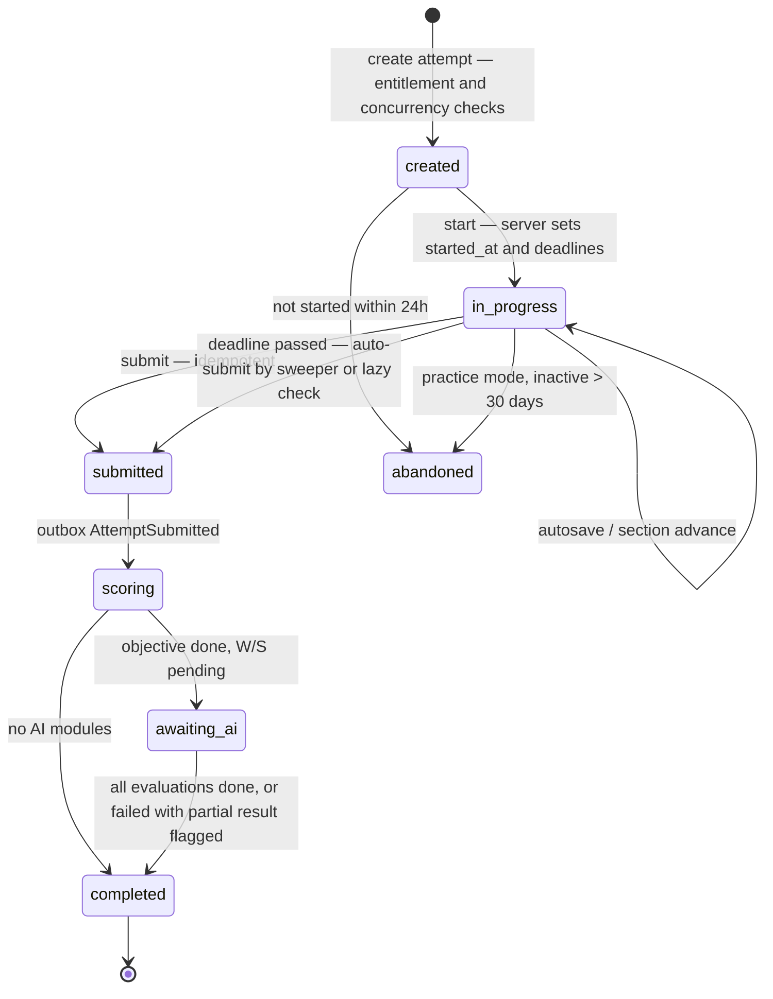
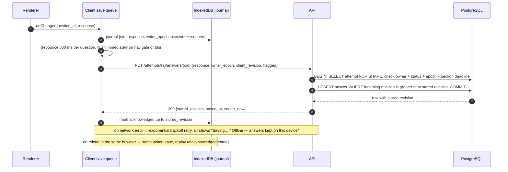
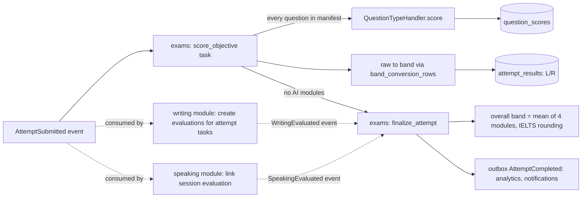

# IELTS MASTER 2.0 — Examination Engine Design

| Field | Value |
|---|---|
| Status | **Draft v0.2 — revised after Phase 1 audit; awaiting approval** |
| Related | `QUESTION_BANK_DESIGN.md`, `DATABASE_SCHEMA.md` §5, `API_SPECIFICATION.md` §6 |
| Last updated | 2026-11-17 |

---

## 0. Implementation status (2026-11-19): Listening attempts

**Reading (2026-11-19):** the same engine serves Reading. Template `reading_only` (migration 0010: exam 60 minutes, server-enforced, auto-submit, 30 s grace; practice untimed guide). `config_snapshot.module` records the module; the time limit comes from `timing.module_seconds`. Review items include the evidence paragraph label. Band conversion still needs an approved table (none seeded). Writing and Speaking do not use attempts: see API_SPECIFICATION (`/writing`, `/speaking`).

Implemented for **Listening only** (`backend/app/modules/exams/`, migration `0009`, candidate UI under `/listening` and `/exam/listening/{id}`):

| Design element | Status |
|---|---|
| `exam_templates` | seeded `listening_only` (`allowed_modes` practice + exam, default practice) with the §2.1 rules; snapshotted into `exam_attempts.config_snapshot` with the question manifest |
| Lifecycle | `created → in_progress → completed`. Objective scoring runs **inside the submit transaction**, so `submitted` and the outbox `AttemptSubmitted` step are not used yet (they arrive with AI-scored modules) |
| Timing (§4) | server `started_at`/`deadline_at`; exam = 1800 s + 120 s transfer, grace 30 s, writes in grace flagged `saved_after_deadline`, after grace `409 attempt_deadline_passed`; practice has no deadline (timer is advisory) |
| Deadline enforcement (§4.1) | lazy check on every attempt read/list + sweeper in the existing outbox worker loop every 30 s (`FOR UPDATE SKIP LOCKED`); no Celery Beat yet |
| Answer persistence (§5) | writer lease (epoch + SHA-256-hashed token), revision-guarded UPSERT under `FOR SHARE`, takeover via `/resume` (`409 superseded_session` for the old lease). **Deviation:** batch `PUT /attempts/{id}/answers` (≤ 50) only, no single-question PUT; the client journal lives in `localStorage` (small JSON per attempt) instead of IndexedDB |
| Submission (§6) | `FOR UPDATE`, `Idempotency-Key`, `final_answers` applied with the revision rule within deadline + grace, otherwise only stored answers are scored |
| Scoring (§7) | every manifest question scored with the registry handler (unanswered = explicit 0 rows in `question_scores`), `attempt_results` raw/max; **band only from an approved default `band_conversion_tables` row set and only for a complete 40-question module**. None is seeded, so no band is shown |
| Audio (§4) | `POST /attempts/{id}/sections/{n}/audio-url`: presigned GET valid for the time limit + 15 min; exam mode records the first play and a reload resumes at the elapsed server offset (`offset_ms`), seeking disabled; practice: replay + seek. The player has no pause in exam mode (realism choice, not a rule field) |
| Concurrency (§9) | one open exam-mode attempt per user/template/version (partial unique index), create is idempotent per `(user, Idempotency-Key)`, manifest membership checked on every write |
| Not yet | practice `/check` and hints (§8), `/status`, SSE, `/advance`, `/exam-templates`, rate limits on autosave/submit, retry_of_attempt_id, abandoned-attempt cleanup, entitlements (premium tests are listed as locked and cannot be started until Phase 8 plans exist) |

Answer keys never leave the content module before completion: attempt content is the handlers' `student_view`; scoring and review data come from `content.api.delivery`; `/attempts/{id}/review` and `/result` answer only for the owner's **completed** attempt.

## 1. Responsibilities

The exams module turns published content into **attempts**. It controls timing and navigation rules, persists every answer durably, handles submission safely, runs objective scoring, routes Writing/Speaking to AI evaluation, and assembles results.

Out of scope for this module: rendering (frontend), content authoring (content module), AI evaluation logic (writing/speaking modules + ai-engine).

## 2. Exam Types and Templates

An **exam template** is a data record (`exam_templates`) describing *what* is assembled and *which rules* apply. Templates are seeded and editable by Admins.

| Template code (examples) | Content source | Modules |
|---|---|---|
| `full_mock_academic` / `full_mock_general` | one test version | L → R → W (+ S optional/scheduled) |
| `listening_only`, `reading_only`, `writing_only`, `speaking_only` | one test version, single module | one |
| `book_section` | a section of a test version | partial module |
| `custom` | student-chosen sections across tests | mixed |
| `randomized_<module>` | random groups from published pool | one |
| `qtype_practice` | groups of one question type | one |

Every template declares `allowed_modes` (subset of `practice`, `exam`) and a `default_mode`. The student picks a mode from `allowed_modes` at attempt creation. The chosen mode is fixed for the life of the attempt.

**Variant resolution (full mocks).** A `full_mock_academic` attempt assembles, from one test version: Listening (`variant = common`), Reading (`academic`), Writing (`academic`), and Speaking (`common`). `full_mock_general` uses `general` for Reading/Writing. Creation fails with `422 test_incomplete_for_template` if any required module/variant is missing in the published version.

### 2.1 Rules (template `rules` JSONB keyed by mode, validated by `ExamRules` Pydantic model)

```json
{
  "exam": {
    "timing": { "scope": "module", "listening_seconds": 1800, "reading_seconds": 3600,
                "writing_seconds": 3600, "transfer_time_seconds": 120, "enforce": true,
                "auto_start_next_module": true },
    "navigation": { "free_within_module": true, "can_return_to_completed_module": false },
    "listening": { "max_plays": 1, "allow_seek": false },
    "feedback": { "instant": false, "show_explanations": "after_completion", "hints": false },
    "submission": { "auto_submit_on_deadline": true, "grace_seconds": 30 }
  },
  "practice": { "...": "same shape, practice defaults below" }
}
```

Practice mode defaults: `enforce: false` (timer shown, optional), `instant: true`, `max_plays: null`, `allow_seek: true`, `hints: true`, re-attempt allowed.
Exam mode defaults: official timings, single audio play, no hints, no reveals, results after completion.

On attempt creation the resolved rules are **snapshotted** into `exam_attempts.config_snapshot` together with the item manifest. Later template edits never affect running or past attempts.

## 3. Attempt Lifecycle



`expired` is not a terminal state for exam-mode attempts with answers. A deadline triggers **submission**, not discard. NFR-RL-01: answers already saved are always scored.

## 4. Server-authoritative Timing

- `start` sets `started_at = now()` and computes `deadline_at` per timed scope (module or section) in `attempt_sections`.
- Timed sections are **sequential**: when the Listening module ends (deadline or "finish"), Reading's clock starts at that server moment, not when the client next calls in (`auto_start_next_module: true`, mirroring the real L → R → W sequence with no break). A student who disconnects keeps losing time, as in the real test. This is shown clearly before the exam starts. Templates may set `auto_start_next_module: false` to start the next module only on an explicit "start" call.
- The client receives `server_now` + `deadline_at` and renders a countdown from the **offset** `deadline_at - server_now`, re-synced on every autosave response. Device clock skew is irrelevant.
- **Deadline vs grace (two different things):**
  - At `deadline_at` (by the server-synced offset) the UI **locks all inputs**, flushes the save queue, and shows "Time is up — saving your answers".
  - The server accepts writes while `now <= deadline_at + grace_seconds` (default 30 s, configurable per template). Grace exists **only** to absorb in-flight requests and retries. It is not extra answering time.
  - Writes received after `deadline_at` but within grace are accepted and **flagged** (`saved_after_deadline = true`) for integrity analytics. A modified client could use at most the grace window, which is an accepted, documented limitation of a browser-based mock test.
  - After grace: `409 attempt_deadline_passed`, no write.
  - The deadline checked is the **timed scope that contains the question** (`attempt_sections.deadline_at`), not only the attempt-level deadline.
- **Pausing** is not available in exam mode. In practice mode, timer state is stored server-side (`paused_at`, `paused_seconds_total`).
- **Listening audio:** in exam mode the server issues the audio URL once per section (`audio_plays_used` counter). The player disables seeking. Reconnection resumes from the elapsed server time offset, so a refresh does not restart audio. **Limitation:** a signed URL can be re-fetched within its TTL, so play limits are a realism/UX control, not anti-cheat. The platform is a practice tool, not a proctored exam.

### 4.1 Deadline enforcement

Two complementary mechanisms:
1. **Lazy:** every request on an attempt checks the deadline first and transitions state if passed.
2. **Sweeper:** a Celery Beat job every 30 s selects `in_progress` attempts where `deadline_at + grace < now()` (partial index) with `FOR UPDATE SKIP LOCKED` and auto-submits them. This covers students who closed the browser.

## 5. Answer Persistence (zero-loss design)



### 5.1 Revision & writer-lease protocol (ADR-013)

- **Writer lease.** `POST /attempts/{id}/start` (or `/resume`) returns a `writer_epoch` (integer, incremented on the attempt row) and a `writer_token` (random secret, hashed on the server). The client stores both **in IndexedDB together with the journal**, so a page reload, a browser crash, or a closed tab reopened on the same browser profile **reuses the same lease**. No new epoch is issued and journal replay is accepted.
- **Revision.** `client_revision` is a per-lease monotonic counter persisted in IndexedDB. The server stores `(writer_epoch, client_revision)` per answer and applies an incoming write only if `(incoming_epoch, incoming_revision) > (stored_epoch, stored_revision)` lexicographically. Out-of-order or retried requests are therefore harmless no-ops (200 with the stored revision returned).
- **Takeover.** Opening the attempt on another device/browser profile (no lease in its storage) requires an explicit "Continue on this device" action → `POST /attempts/{id}/resume` → `writer_epoch + 1`. Writes carrying an older epoch are rejected with `409 superseded_session`, and that client shows "continued on another device". **Unacknowledged answers left on the old device are not merged**: they were never acknowledged, so NFR-RL-01 (no loss of *acknowledged* answers) still holds. The takeover dialog warns about this explicitly when the server sees recent writes from the old lease (< 30 s).
- **Answer clearing** is a write like any other (`response: null`), so revision rules apply.
- **Server is the source of truth.** IndexedDB is only an outbox for not-yet-acknowledged writes. On resume the client loads server answers first and replays only journal entries newer than the stored revision.

### 5.2 Locking & transaction boundary

- Autosave runs in one short transaction: `SELECT … FROM exam_attempts WHERE id = :id AND user_id = :uid FOR SHARE`, then status, epoch, and section-deadline checks, then the UPSERT. `FOR SHARE` lets concurrent autosaves on the same attempt proceed in parallel but **conflicts with submit's `FOR UPDATE`**. Every acknowledged save therefore commits strictly before or after the submit transaction, never "during". A save that waits behind a committed submit then sees `status = submitted` and is rejected (`409 attempt_submitted`) unless within grace, where it is handled as in §6.
- Redis `attempt:{id}:state` (status/deadline cache) is used only as a **fast-path reject** (e.g., an obviously finished attempt), never to accept a write.
- Latency target p95 < 150 ms (NFR-PF-02): one indexed row lock (shared) + one composite-PK UPSERT.
- Batch endpoint `PUT /attempts/{a}/answers` (≤ 50 items, one transaction) for flush-on-reconnect.

### 5.3 Writing tasks inside attempts

Writing text in an attempt is stored in `writing_submissions` (owned by the **writing** module) with `attempt_id` set. The frontend autosaves via `PUT /writing/submissions/{id}` (3 s debounce) using the same `writer_epoch` + `client_revision` protocol. The writing service calls `exams.api.assert_writable(attempt_id, user_id, writing_task_id)`, which performs the same `FOR SHARE` lock and deadline checks. The dependency direction stays writing → exams (ADR-014).

## 6. Submission

`POST /attempts/{id}/submit` with header `Idempotency-Key: <uuid>` and an optional body `{writer_epoch, final_answers: [{question_id, response, client_revision}] (≤ 200)}`.
1. `SELECT … FOR UPDATE` attempt (waits for in-flight autosave transactions holding `FOR SHARE`).
2. If already `submitted`/later with the same key, return the existing result (200). With a different key, return 409 with the current state.
3. Validate ownership, state, and `writer_epoch`. Apply `final_answers` with the normal revision rule (accepted only within deadline + grace), set `submitted_at`, status `submitted`, and write outbox `AttemptSubmitted`, **all in the same transaction**.
4. Respond 202 with the status URL. The client polls `GET /attempts/{id}/status` (or listens to SSE `/attempts/{id}/events`).

The frontend flushes the save queue before calling submit and waits for acknowledgements. If saves are still unacknowledged after a short timeout, the remaining journal entries are sent as `final_answers` in the submit body. Auto-submission by the sweeper uses only what the server already holds.

## 7. Scoring Pipeline



Orchestration is **event-driven** (ADR-014). The exams module never calls writing/speaking. Those modules subscribe to `AttemptSubmitted`, and exams subscribes to their `*Evaluated` events. `finalize_attempt` is idempotent and runs whenever an awaited result arrives. It completes the attempt once every expected module result exists or has permanently failed.

- Scoring iterates the attempt's **manifest** (`config_snapshot.items`), not the saved answers, so unanswered questions get explicit 0-mark rows.
- Scoring tasks are idempotent: `question_scores` UPSERT by PK, and `attempt_results` unique per (attempt, module).
- **Bands only for complete modules.** A module band estimate is produced only when the attempt covered the complete module (all sections/passages). Partial attempts (`book_section`, `qtype_practice`, `custom` subsets, `randomized_*`) report raw score and accuracy only.
- **IELTS rounding (overall):** overall = mean of module bands, rounded to the nearest 0.5. A .25 rounds up to the next half band, a .75 rounds up to the next whole band (as published by IELTS). Implemented once in `shared/banding.py` with exhaustive tests.
- **Writing module band (assumption, configurable):** Task 2 carries more weight than Task 1, which IELTS states publicly. The exact weighting/rounding is not officially published. The default, `(T1 + 2 × T2) / 3` rounded to the nearest 0.5, is a **documented assumption** stored as a versioned banding rule and labelled "estimated".
- Band conversion tables are **data** (approximations of publicly known ranges), editable by Admins, versioned, and always presented as estimates.
- If an AI evaluation fails permanently, the attempt still completes, with that module marked `evaluation_failed` and the overall band withheld. The student can retry the evaluation without consuming quota.

## 8. Practice-mode Specifics

- `POST /attempts/{id}/answers/{qid}/check` returns correctness + explanation for that question (practice only; 403 `mode_forbidden` in exam mode). The check is recorded so analytics can distinguish "checked before final answer".
- Hints: `GET /attempts/{id}/questions/{qid}/hint`. Authored hints are preferred, otherwise an AI-generated hint (quota-limited, never reveals the answer, filtered by a guardrail that rejects outputs containing the key).
- Re-attempt creates a new attempt referencing `retry_of_attempt_id`.

## 9. Concurrency & Integrity

- One open exam-mode attempt per (user, template, test_version): partial unique index on `(user_id, template_id, test_version_id) WHERE mode = 'exam' AND status IN ('created','in_progress')`. For templates without a fixed test version (`randomized_*`, `custom`), the service enforces **one open exam-mode attempt per (user, template)** (a second partial unique index on `(user_id, template_id) WHERE test_version_id IS NULL AND mode = 'exam' AND status IN (…)`). Practice allows parallel attempts.
- Cross-device: see the writer-lease protocol (§5.1). Only one writer lease is valid at a time.
- **Content pinning:** an attempt references `test_version_id` (FK `RESTRICT`) and its manifest lists question IDs of that immutable version. Every answer write validates `question_id ∈ manifest`.
- Answer keys are never sent to the client during an exam-mode attempt (handler `student_view`). Explanations are fetched only after `completed`.
- Rate limits: autosave 10 req/s per attempt (burst 30), submit 5/min.

## 10. Results Report

`GET /attempts/{id}/result` (owner or staff):
- Module bands (estimate badges), raw scores, per-section breakdown.
- Per question type accuracy for this attempt and delta vs the student's rolling average.
- Answer review: student response, correct answer(s), explanation, evidence location (paragraph highlight / audio timestamp jump).
- Writing/Speaking: links to their evaluation reports.

## 11. Testing (critical-path)

- Unit: state machine transitions (exhaustive table), deadline math with frozen clocks, banding/rounding, revision ordering.
- Integration: out-of-order and duplicated autosaves (highest revision wins), stale writer epoch rejected after takeover, journal replay after reload with the same lease accepted, autosave racing submit (every 200-acknowledged answer appears in scoring input), save-after-deadline within/after grace, sweeper auto-submit, submit idempotency under parallel requests, scoring idempotency (run task twice → same rows), unanswered questions scored 0.
- E2E (Playwright): full reading exam with forced offline period + reload → no lost answers; listening single-play enforcement; auto-submit on deadline; takeover from a second browser context.
- Load (k6): 1,000 concurrent attempts autosaving every ~10 s, p95 < 150 ms, zero errors.
