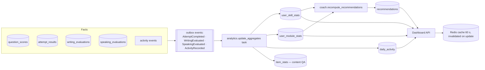

# IELTS MASTER 2.0 — Learning Analytics Design

| Field | Value |
|---|---|
| Status | **Draft v0.1 — awaiting approval** |
| Modules | `analytics` (read models), `coach` (recommendations, plans) |
| Related | `DATABASE_SCHEMA.md` §7, `AI_ENGINE_ARCHITECTURE.md` §6 |
| Last updated | 2026-11-17 |

---

## 1. Principles

1. **Facts first.** Every metric is derived from stored facts (`question_scores`, `attempt_results`, `writing_evaluations`, `speaking_evaluations`, activity). Nothing is invented. AI only interprets.
2. **Write-time aggregation.** Dashboards read small pre-aggregated rows and never scan raw answers on request.
3. **Rebuildable.** Every aggregate can be recomputed from facts by a backfill job (needed when scoring or rules change).
4. **Estimates are labelled.** Any band figure is an estimate with its basis ("based on your last 3 Reading exams").

## 2. Data Flow



Updates are incremental (per event, idempotent via `processed_events(event_id)` dedupe). A nightly job reconciles a sample of users against a full recompute and alerts on drift.

## 3. Metrics Definitions

| Metric | Definition |
|---|---|
| Accuracy by question type | `correct / attempted` for that (module, question_type), plus EWMA (α = 0.2) to favour recent performance. Only exam + practice final answers count; "checked" answers in practice are excluded from accuracy and tracked separately |
| Module latest band | Band of the most recent completed exam-mode attempt of that module |
| Module rolling band | Median of the last 3 exam-mode bands (robust to one bad day); requires ≥ 1 |
| Overall estimated band | IELTS rounding of the mean of the four rolling module bands. Shown only when all four exist, otherwise "x of 4 modules assessed" |
| Trend | Last 20 module bands with dates (JSONB array on `user_module_stats`, for sparkline rendering) |
| Book completion | Distinct test modules completed / total test modules in the book's published versions |
| Practice streak | Consecutive days (user's timezone) with ≥ 1 meaningful activity (≥ 5 questions, or a writing submission, or ≥ 3 min speaking) |
| Weak question types | Types with ≥ 10 attempts and accuracy EWMA below the student's module mean by ≥ 10 pp, or below the threshold implied by the target band |
| Writing/Speaking criterion trends | Per-criterion band over time from evaluations |
| Time per question | Median dwell time from autosave timestamps (approximate, labelled) |

Thresholds are configuration, not code constants.

## 4. Recommendation Engine (rule-based core + AI explanation)

Recommendations are generated **deterministically**, so they are explainable and testable:

```
for each weak question type (sorted by gap × importance):
    pick 1–2 qtype_practice sets not attempted in the last 14 days
if a module has no assessment in > 21 days → recommend a module exam
if exam_date within 30 days → prioritise full mocks (1/week), timed mode
if writing criterion consistently lowest (≥ 3 evaluations) → targeted writing task + resource (RAG)
cap: ≤ 5 active recommendations; expire after 7 days
```

Each recommendation stores `reason_code` + `evidence` (stat references). The LLM may *phrase* the explanation ("Your Matching Headings accuracy is 48% vs 71% overall…") using only the evidence values (no-fabrication checker, `AI_ENGINE_ARCHITECTURE.md` §6).

## 5. Study Plans

Input: target band, exam date, available minutes/day (asked from the student), current module stats, weak types.
Process: deterministic scheduler builds a skeleton (weekly mix by module gap) → LLM refines the ordering/rationale (structured output) → validator checks references and constraints → persist `study_plans` + `study_plan_items`.
Plans adapt weekly: a beat job re-evaluates progress and proposes adjustments (the student accepts or dismisses them).

## 6. Weekly Summary

Beat job (per user timezone, Monday morning): compute week deltas from aggregates → template-based summary with optional LLM phrasing → in-app notification + email (if opted in). Users who were inactive that week get a short re-engagement version, rate-limited.

## 7. Dashboard API Shape

`GET /api/v1/me/dashboard` returns one cached payload:
```json
{
  "overall": {"band": 6.5, "basis": "rolling", "modules_assessed": 4, "disclaimer": "estimate"},
  "modules": [{"module": "reading", "latest": 6.5, "rolling": 6.5, "trend": [...], "exams_taken": 5}],
  "weak_question_types": [{"module": "reading", "type": "matching_headings", "accuracy": 0.48, "attempted": 25}],
  "recent_attempts": [...5],
  "books": [{"book_id": "...", "completion": 0.35}],
  "streak": {"current": 4, "best": 12},
  "recommendations": [...],
  "recent_feedback": [{"kind": "writing", "evaluation_id": "...", "overall": 6.0}]
}
```
Heavier views (full history, per-book drill-down) are separate paginated endpoints.

## 8. Platform (Admin) Analytics

- Business: signups, DAU/WAU/MAU, conversion, churn, MRR (from billing tables).
- Engagement: attempts started/completed, completion rate, speaking minutes.
- Content QA: item stats (p-value, discrimination), flagged items, most-attempted tests.
- AI: cost per feature/day, evaluations per day, failure rates, latency percentiles.

These are served from the read-only role/replica, with daily rollup tables (`platform_daily_metrics`) to avoid heavy live queries.

## 9. Privacy

Analytics on individuals is visible only to the student and staff with `users.analytics.read`. Platform analytics uses aggregates only. Exports to any external analytics tool (if adopted later) use pseudonymous IDs and no content text.
