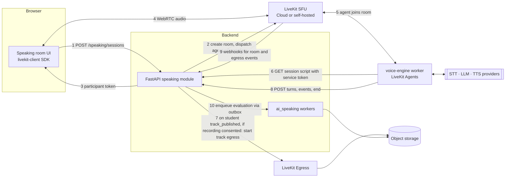
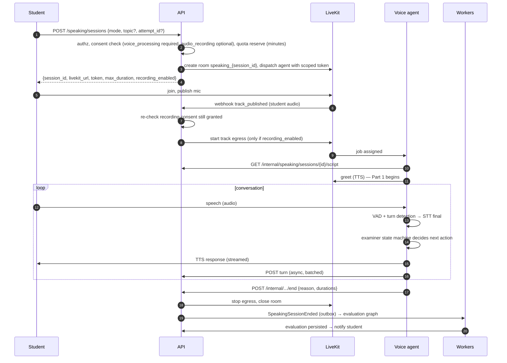
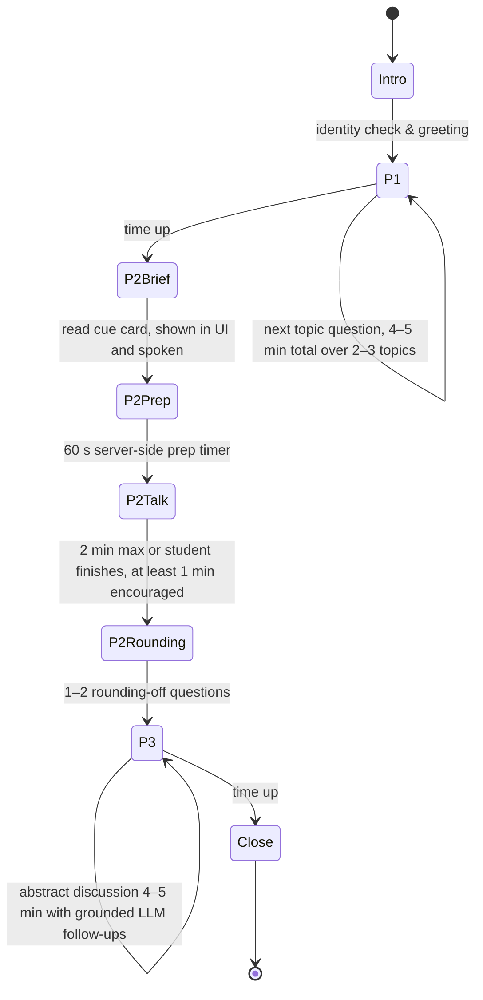

# IELTS MASTER 2.0 — Real-Time Speaking Architecture

| Field | Value |
|---|---|
| Status | **Draft v0.2 — revised after Phase 1 audit; awaiting approval** |
| Runtime | `voice-engine/` (LiveKit Agents, Python) — ADR-004, ADR-010 |
| Open decisions | D-02 LiveKit Cloud vs self-host · D-03 pronunciation provider · D-07 STT/LLM/TTS defaults |
| Last updated | 2026-11-17 |

---

## 1. Design Split

| Concern | Where | Latency budget |
|---|---|---|
| Live conversation (listen → understand → respond → speak) | voice-engine | **target** p50 < 1.2 s, p95 < 2.0 s voice-to-voice (NFR-PF-04). Measured, not guaranteed; unvalidated until the Phase 10 prototype |
| Session control, consent, quotas, question selection, persistence | backend `speaking` module | request/response |
| Recording | LiveKit Egress → object storage | async |
| Detailed evaluation | `ai_speaking` workers (LangGraph) | minutes |

The live loop is optimised only for **natural, fast conversation**. All heavy analysis runs after the session (FR-SP-05).

## 2. Components & Communication



- **Agent dispatch:** explicit dispatch by the backend for the room (agent name `ielts-examiner`). The **agent-dispatch job metadata** carries `session_id` and a short-lived **service token scoped to that session** (JWT signed by the backend: `aud=voice-internal`, `sub=session_id`, TTL = max session duration + 15 min, allowed operations: read script/state, write state/turns/end/usage for that session only). Dispatch metadata goes to the agent worker, unlike room/participant metadata, which participants can read. *Assumption to verify in the Phase 10 prototype against the LiveKit Agents version in use.* If the assumption fails, the fallback is that the agent exchanges `session_id` for a scoped token using its own service identity (below).
- **Voice-engine service identity:** each voice-engine deployment holds one long-lived credential (an API key in the secret manager, rotated quarterly, IP-restricted to voice VMs) used **only** for (a) the token-exchange fallback and (b) health/usage endpoints not tied to a session. It cannot read any student data by itself.
- **Participant token:** issued by the backend with grants limited to that one room, publish audio only (no video, no data publish except the typed control channel), TTL 10 min to join.
- LiveKit webhooks are verified with the LiveKit API secret signature and processed idempotently (keyed by webhook event id).

## 3. Session Lifecycle



Hard limits: max session duration per mode (full mock ≈ 15 min + buffer), idle timeout (no student speech for 60 s → prompt, 120 s → end), quota-based cutoff with a spoken warning 1 minute before.

## 4. Examiner Model (ADR-010)

A **deterministic state machine** drives the IELTS structure. The LLM is used inside states for natural phrasing and short follow-ups.



- Each state has: allowed actions, time budget, question pool (from the content module or `speaking_topics`), and an LLM prompt for phrasing.
- **Examiner behaviour rules** (in system prompt + post-filter): no feedback or correction during exam mode, no teaching, short neutral turns, never reveals scoring, steers off-topic answers back, refuses non-IELTS requests politely.
- **Practice/free-conversation modes** use a different state graph (tutor persona, may give light feedback, unlimited follow-ups).
- **Interviewer-style practice (`interview` mode, brief §7):** the examiner persona runs an unscripted interview on a chosen topic area. It uses the formal examiner tone and no feedback during the session, but has no fixed Part 1/2/3 timing. Questions come from the topic bank, and LLM follow-ups are bounded by the topic.
- Mode configuration comes from the script payload, so the voice engine never hardcodes content.

## 5. Real-Time Audio Pipeline

```
mic → WebRTC (Opus) → LiveKit → agent
   → noise suppression (LiveKit/Krisp-class filter, optional)
   → VAD (Silero)
   → streaming STT (interim + final)
   → turn detector (semantic end-of-utterance model + silence threshold)
   → examiner state machine → LLM (streaming, short max_tokens)
   → TTS (streaming, first audio chunk ASAP)
   → LiveKit → student
```

| Mechanism | Setting (initial, tuned via telemetry) |
|---|---|
| End-of-turn | Semantic turn detector + min silence ~500–700 ms; **longer in Part 2** (students pause to think during the long turn; we wait up to ~3 s and never interrupt before the 2-minute mark unless silence > 8 s) |
| Barge-in / interruption | Student speech during TTS stops playback within ~200 ms, the agent's unfinished utterance is truncated in context |
| Backchannel | Avoided in exam mode (real examiners are mostly silent), optional in practice |
| Preemptive generation | Start the LLM on high-confidence interim transcripts, discard if the final differs materially |
| Latency budget (p50, **planning estimate**) | STT final ~250 ms · LLM first token ~400 ms · TTS first audio ~200 ms · network ~150 ms ≈ **~1.0–1.2 s** |

The budget is a planning estimate, not a measured result. Actual latency depends on providers, region, and network, and is **measured** per stage (VAD end → STT final → LLM first token → TTS first byte → playout) as Prometheus histograms. Targets are NFR-PF-04, and dashboards alert if p95 > 2 s. The Phase 10 prototype must produce measured p50/p95 for at least two provider combinations before the pipeline is finalised. If targets can't be met, we report the measured numbers and adjust the target or the providers. We do not claim the target.

## 6. Recording, Storage & Privacy

- **Two separate consents (versioned in `user_consents`):**
  1. `voice_processing` (**required to use speaking at all**): live audio is streamed to the configured STT/LLM/TTS processors to run the conversation and produce a transcript. The UI names the processor categories and links the privacy policy.
  2. `audio_recording` (**optional**): the student's audio is stored for pronunciation assessment and playback, under the retention period.
- **No-recording mode:** with only `voice_processing`, the session runs normally, but no egress is started and no audio is stored. The evaluation is transcript-based only (FC/LR/GRA estimates), with **no pronunciation band**, clearly labelled.
- **Consent enforcement points:** checked at session creation **and** again when the backend receives `track_published` before starting egress. Withdrawing `audio_recording` mid-session stops egress immediately (`StopEgress`), and the partial recording is deleted.
- **Recording:** LiveKit **track egress** of the student's audio track only (examiner TTS is reproducible from the transcript) → `recordings/{user_id}/{session_id}/…` in a private bucket with server-side encryption.
- **Access:** only the owner (and staff with `speaking.recordings.read`, audited) via signed URLs (≤ 5 min TTL).
- **Retention (proposed default, pending D-12):** raw audio 90 days after the session, transcripts and evaluations until account deletion. Implemented via `audio_purge_after` + nightly purge job + bucket lifecycle rule as a backstop.
- **Deletion behaviour:** "Delete recording" (`DELETE /speaking/sessions/{id}/recording`) removes the stored objects synchronously where possible (async retry otherwise), nulls `speaking_recordings.media_asset_id`, keeps the evaluation, and marks the pronunciation section as "audio deleted — playback unavailable". Account deletion purges recordings within the account purge job. Backups containing audio age out per the backup retention window (documented in the privacy policy).
- Minors: see `SECURITY_GUIDELINES.md` §11 and D-13.

## 7. Post-session Evaluation Hand-off

`SpeakingSessionEnded{session_id}` → `speaking_eval` graph (`AI_ENGINE_ARCHITECTURE.md` §5):
1. Wait for egress completion (LiveKit `egress_ended` webhook) or time out at 10 min and fall back to the live transcript only (no pronunciation band, flagged).
2. Batch STT on the recording (higher accuracy, word timings). The live transcript is kept for comparison.
3. Segment student turns by part, run the pronunciation assessor, compute metrics, run criterion assessors.
4. Persist `speaking_evaluations`, notify the student (in-app + optional email).

## 8. Failure Handling

| Failure | Behaviour |
|---|---|
| Agent crash mid-session | The backend detects the agent leaving (LiveKit `participant_left` webhook for the agent identity) and **explicitly re-dispatches** a new agent with a fresh scoped token. The new agent reloads state from `GET /internal/.../state` (last turn index, current part, timer deadlines persisted every turn) and resumes with "Sorry, let's continue…". Automatic re-dispatch by LiveKit itself is not relied on (*unverified for our version; tested in the prototype*). |
| STT/LLM/TTS provider error | Per-stage fallback provider (configurable). If it's unrecoverable, apologise via cached TTS phrase, end the session gracefully, and refund unused minutes |
| Student network drop | LiveKit client auto-reconnect. The room and agent wait up to 60 s (`departure_timeout`). The agent pauses its turn and timers in **practice**. In **exam/full-mock** mode the part timers continue (as in the real test), but the agent does not ask the next question until the student is back. On return the agent says "Welcome back" and repeats the last question. After 60 s the session ends with reason `student_disconnected`, the evaluation runs on what was captured, and unused minutes are refunded |
| Student interrupts the examiner (barge-in) | TTS stops, the interrupted utterance is truncated in the LLM context, and the turn is processed normally. In Part 2 the agent never barges in on the student |
| Egress failure | Evaluation proceeds transcript-only, pronunciation marked unavailable, quota partially refunded per policy |

## 9. Scaling & Deployment

- The voice engine is stateless between jobs (state is in the backend + room). Scale horizontally; each worker advertises load to LiveKit and dispatch balances automatically.
- Sizing guide (to validate with load tests): with cloud STT/LLM/TTS (no local models besides VAD/turn detector), ~20–40 concurrent sessions per 4 vCPU worker.
- Region: deploy voice workers in the same region as the LiveKit server/Cloud region nearest the user base. Provider endpoints should be chosen in-region where possible.
- **D-02 recommendation:** LiveKit Cloud initially (managed SFU, TURN, global edge, egress included), with a self-host migration path (same SDKs) if cost at scale justifies it.

## 10. Testing

- Unit: examiner state machine (timings, transitions, mode rules), filler/repetition detectors, latency budget accounting, consent gating (no egress without `audio_recording`).
- Integration: agent against a local LiveKit dev server with synthetic audio fixtures (recorded prompts) verifying turn-taking and part transitions.
- Provider failure injection (fake providers raising/timeouts).
- Load: synthetic participants publishing audio files to measure per-worker capacity and latency percentiles.

## Implementation status (2026-11-19): AI Speaking Room, voice not connected

**Built**
- Rooms are `speaking_sessions` rows with `kind = 'room'` (migration 0012): examiner profile,
  published examiner configuration, frozen `config_snapshot` (examiner, structured instructions,
  the 10 conversation rules, timing, follow-up settings, criteria, ordered step plan), lifecycle
  `created -> live -> completed`, `started_at` / `ended_at` / `duration_seconds` /
  `completion_reason`. Transcript lines live in `speaking_turns` (`seq`, speaker, part, text,
  offset, meta).
- **Guided mode** (used whenever no voice provider is registered): the server emits examiner
  lines only from the frozen plan, one question at a time; each candidate step needs a verified
  recording (existing presigned MinIO flow) before the room advances. Candidate transcript text
  appears only after speech-to-text runs in evaluation; nothing is invented. Follow-up questions
  are not generated in guided mode.
- Completion queues the existing Speaking evaluation job (`unavailable` without providers).

**Integration boundary for LiveKit (not connected)**
- `app/modules/speaking/voice.py`: `SpeakingVoiceProvider` (`create_session(RoomContext) ->
  VoiceConnection`, `end_session(room_code)`), `register()`. When an adapter is registered,
  `POST /speaking/rooms/{id}/enter` sets `conduct_mode = 'live'` and returns the connection
  (URL + token) to the browser; no server-side examiner lines are written.
- Transcript/lifecycle events: `POST /api/v1/internal/speaking/rooms/{id}/events` with
  `X-Internal-Token` (setting `SPEAKING_EVENTS_TOKEN`; unset = endpoint answers 404). Events
  `{seq, type: transcript|part|completed, speaker, text, part_no, offset_ms, meta}`; idempotent on
  `(session, seq)`; accepted only for live rooms.

**Still needed from the product owner:** LiveKit URL / API key and secret (server-side only),
agent/worker deployment, the voice/LLM/STT/TTS model choice and their keys, the mapping of
`examiner_profiles.voice` to provider voices, and the agent's prompt built from
`RoomContext.instructions` + `plan`. The browser LiveKit client (joining with the returned
token and rendering events) is not added yet.

## Implementation status (2026-11-19, later): LiveKit + Gemini Live connected

- Backend registers `LiveKitVoice` (`app/modules/speaking/livekit_voice.py`) when `LIVEKIT_URL`,
  `LIVEKIT_API_KEY` and `LIVEKIT_API_SECRET` are set: entering a room creates the LiveKit room,
  dispatches agent `ielts-examiner` with the frozen room context, and returns a 30-minute
  participant token; `POST /speaking/rooms/{id}/voice-token` re-issues one after a reload.
- Agent: `voice-engine/ielts_voice/agent.py` (`uv run python -m ielts_voice.agent dev`), LiveKit
  Agents 1.8 + Gemini Live (`GEMINI_LIVE_MODEL`, default `gemini-3.8-live`, API version
  `v1alpha` — `v1beta` returns HTTP 404 for AI Studio keys). Tools: `begin_part`,
  `start_preparation` (waits the configured Part 2 preparation), `end_test`. Every utterance is
  posted to the internal events endpoint (`SPEAKING_EVENTS_TOKEN`).
- Live-room evaluation uses the real-time transcript (no recordings). Pronunciation is still not
  assessed (no audio pronunciation assessor), so no overall Speaking band is given.
- Verified locally: room creation, dispatch, token minting, Gemini Live connection and the
  agent's first tool call. Not yet verified: a full spoken test by a human in a browser.
