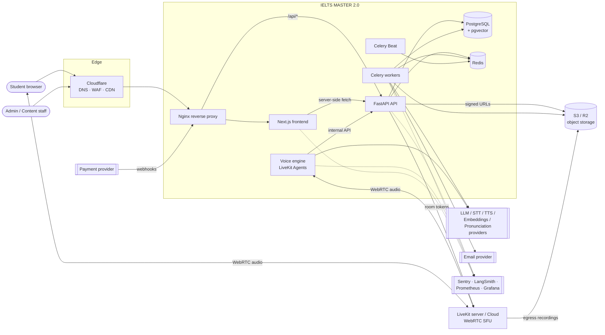
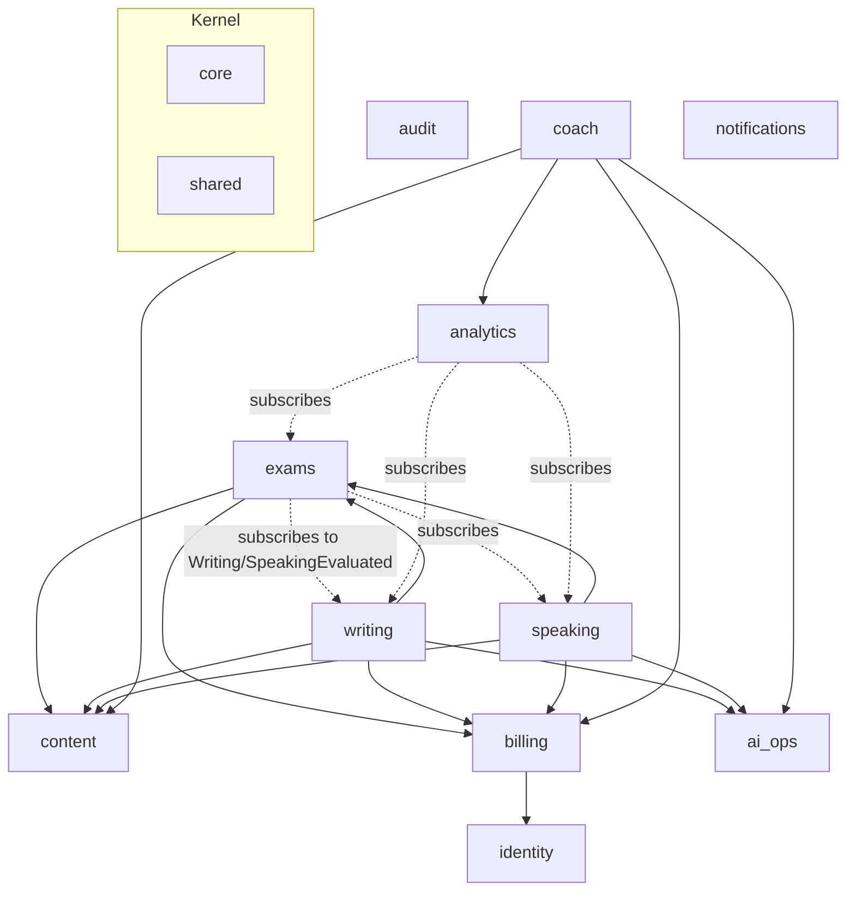
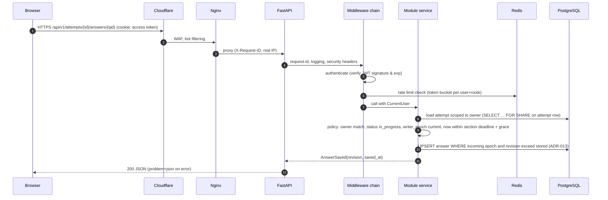

# IELTS MASTER 2.0 — System Architecture

| Field | Value |
|---|---|
| Status | **Draft v0.2 — revised after Phase 1 audit; awaiting approval** |
| Depends on | `PROJECT_REQUIREMENTS.md` |
| Last updated | 2026-11-17 |

---

## 1. Architectural Style

**Modular monolith + independently deployable runtimes.**

- One Python codebase (`backend/`) contains all business domains as modules with enforced boundaries. It is deployed as **two process types from one image**: the **API** (FastAPI/Uvicorn) and **Workers** (Celery). Same code, same domain models, no duplication.
- One AI library (`ai-engine/`) that holds provider abstractions, LangGraph workflows, prompts, and evaluation harnesses. It is a **pure library with no database access**: it takes typed inputs and returns typed outputs. The backend workers call it, and so does the voice engine.
- One voice runtime (`voice-engine/`): a LiveKit Agents worker, deployed and scaled on its own, that talks to the backend only through an authenticated internal API.
- One web app (`frontend/`): Next.js App Router, which handles SSR/SEO for public pages and runs the student and admin dashboards.

This gives us monolith simplicity (one DB, transactions, one deploy pipeline for business logic) while isolating the three workloads with radically different scaling profiles: request/response, long-running async AI, and real-time audio.

### 1.1 Context diagram



---

## 2. Repository Structure

A refinement of the proposed structure. The main change: **there is no top-level `workers/` directory.** Celery tasks live inside each backend module next to the domain logic they run, and `backend/app/workers/` holds only the Celery app, routing, and beat schedule. A separate `workers/` tree would need to either duplicate the domain models or import across top-level packages, which creates exactly the coupling we want to avoid (ADR-002).

```
ielts-master/
├── frontend/                       # Next.js 16 App Router, TypeScript strict
│   ├── src/app/
│   │   ├── (public)/               # marketing, pricing, blog — SSR/SSG, SEO
│   │   ├── (auth)/                 # login, register, reset
│   │   ├── (student)/              # dashboard, library, practice, results, coach
│   │   ├── (exam)/                 # distraction-free exam shell (own layout)
│   │   ├── (speaking)/             # speaking room
│   │   └── (admin)/                # admin + CMS
│   ├── src/components/ui/          # shadcn/ui primitives (design system)
│   ├── src/components/questions/   # question renderers, one per type, registry
│   ├── src/features/<domain>/      # feature-sliced: api hooks, stores, components
│   ├── src/lib/api/                # generated OpenAPI client + fetch wrapper
│   └── tests/                      # component tests; e2e lives in /tests/e2e
├── backend/                        # FastAPI modular monolith (package: app)
│   ├── app/
│   │   ├── main.py                 # API entrypoint
│   │   ├── core/                   # config, db session, security, errors, logging, telemetry
│   │   ├── shared/                 # tiny cross-cutting kernel: ids, time, pagination, events
│   │   ├── modules/
│   │   │   ├── identity/           # users, auth, sessions, roles, permissions, consent
│   │   │   ├── content/            # books, editions, tests, versions, items, media, imports
│   │   │   ├── exams/              # templates, attempts, answers, timers, scoring
│   │   │   ├── writing/            # submissions, evaluations (calls ai-engine)
│   │   │   ├── speaking/           # sessions, recordings, transcripts, evaluations
│   │   │   ├── analytics/          # aggregates, progress, dashboard read models
│   │   │   ├── coach/              # study plans, recommendations, coach chat
│   │   │   ├── billing/            # plans, entitlements, subscriptions, payments, usage
│   │   │   ├── ai_ops/             # prompt versions, AI request log, eval runs, provider config
│   │   │   ├── notifications/      # email + in-app
│   │   │   └── audit/              # audit log write/read
│   │   └── workers/                # celery_app.py, queues, beat schedule
│   ├── migrations/                 # Alembic (single linear history)
│   └── tests/                      # unit / integration / api
├── ai-engine/                      # Python package: ielts_ai (no DB access)
│   ├── ielts_ai/providers/         # LLM, STT, TTS, Embeddings, Pronunciation interfaces + adapters
│   ├── ielts_ai/graphs/            # LangGraph workflows (writing_eval, speaking_eval, coach)
│   ├── ielts_ai/prompts/           # versioned prompt templates (files) + rubric definitions
│   ├── ielts_ai/schemas/           # Pydantic structured-output models
│   ├── ielts_ai/guardrails/        # input validation, injection detection, evidence verification
│   └── evals/                      # datasets, harness, regression thresholds
├── voice-engine/                   # LiveKit Agents worker (package: ielts_voice)
│   ├── ielts_voice/agent.py        # session entrypoint
│   ├── ielts_voice/examiner/       # deterministic examiner state machine + LLM phrasing
│   └── tests/
├── infrastructure/
│   ├── docker/                     # Dockerfiles per runtime
│   ├── nginx/
│   ├── monitoring/                 # prometheus, grafana dashboards, alert rules
│   └── ci/                         # reusable CI scripts
├── .github/workflows/              # GitHub Actions
├── docs/
├── scripts/                        # dev tooling, seeders (dev-only data), import CLIs
├── tests/
│   ├── e2e/                        # Playwright
│   └── load/                       # k6
├── docker-compose.yml              # local dev
├── pyproject.toml                  # uv workspace root: backend, ai-engine, voice-engine
├── .env.example
└── README.md
```

**Python workspace:** a single `uv` workspace with three members (`backend`, `ai-engine`, `voice-engine`). One lockfile keeps dependency versions consistent. `voice-engine` depends on `ai-engine`, and `backend` will depend on it from Phase 8, when the first AI feature uses it. Nothing depends on `backend` (ADR-003).

**Implementation status (Phase 2).** The tree above is the target. Phase 2 created: the uv workspace and the three Python packages; `backend/app/{core,shared,modules/*}` (the modules are empty boundary packages); `frontend/src/app` (layout, home, `/status`, `/healthz`) and `frontend/src/lib`; `infrastructure/docker/` (backend and frontend Dockerfiles); `.github/` (CI workflow, PR template, CODEOWNERS placeholder); and placeholder `scripts/` and `tests/` folders. **Phase 5a (content domain)** added `backend/app/modules/{content,audit}` (models, question types, validator, versioning service, importer, `api.py`), migrations `0002`–`0005`, `scripts/content_cli.py`, and `docs/schemas/`. **Phase 4 (design system)** added `frontend/src/components/{ui,patterns,layout}`, `frontend/src/lib/{api,query}`, the route groups `(public)`, `(student)`, `(admin)`, `(exam)`, `(speaking)`, and `scripts/{export_openapi,check_contrast}.py` (`FRONTEND_DESIGN_SYSTEM.md`). `frontend/src/features` is still not created (first feature: Phase 5/6). **Phase 3 (database foundation)** added `backend/app/core/{orm,database}.py`, `backend/app/shared/ids.py`, `backend/alembic.ini`, `backend/migrations/` (revision `0001`), and a one-off `migrate` Compose service. Not created yet, by design: `backend/app/workers`, `frontend/src/components`, `frontend/src/features`, `infrastructure/{nginx,monitoring,ci}`. Each is added in the phase that first needs it.

---

## 3. Module Boundaries

### 3.1 Module map and allowed dependencies



All modules may depend on `core`, `shared`, `audit` (write-only `audit.api.record()`), and the `identity` public interface (current user, permission checks). These universal dependencies are not drawn. Solid arrows are synchronous calls through the target module's **public service interface**. Dotted arrows mean "the module at the tail **subscribes to events published by** the module at the head" (in-process event bus + outbox, §5). Subscribing creates no import dependency on the publisher's internals, only on its published event schema in `api.py`. Writing and speaking call `exams.api` (e.g., `assert_writable`, attempt linkage), and exams never calls them back synchronously (ADR-014).

### 3.2 Rules (enforced by `import-linter` in CI)

1. A module exposes only `modules/<name>/api.py` (its public service interface + DTOs) to other modules. Its `models`, `repositories`, and `services` internals are private.
2. No cross-module ORM relationships beyond foreign keys. A module never queries another module's tables directly.
3. The dependency graph is acyclic. When a reverse dependency is needed, use a domain event.
4. `ai-engine` never imports `backend`. `voice-engine` never imports `backend`; it uses the internal HTTP API.
5. A module that will later be extracted into a service (likely candidates: `speaking`, `ai_ops`/evaluation workers, `analytics`) already talks through its `api.py`, so extraction only means replacing in-process calls with RPC.

### 3.3 Internal layering of a module

```
modules/exams/
  api.py           # public interface for other modules (Protocol + DTOs)
  router.py        # FastAPI routes (student); router_admin.py for /admin
  schemas.py       # Pydantic request/response models
  service.py       # business logic, transactions, authorization decisions
  repository.py    # SQLAlchemy queries (async), no business rules
  models.py        # SQLAlchemy ORM models
  tasks.py         # Celery tasks (thin: load → call service → persist)
  events.py        # events this module publishes/handles
  policies.py      # ownership & permission policies
```

Routers stay thin: they validate, check auth, call the service, and map to a schema. Services own transactions: one unit of work per use case.

---

## 4. Request Lifecycle



**Frontend data paths**

- **Public pages:** Next.js Server Components fetch from the API server-side, with ISR caching for library listings.
- **Authenticated pages:** Server Components forward the user's cookie to the API on the internal network for the initial render. Client components use TanStack Query against `/api/v1/*` on the **same origin** (Nginx routes `/api/` to FastAPI). Same-origin means first-party httpOnly cookies, no CORS in production, and simpler CSRF handling (ADR-006).
- Next.js is **not** a BFF holding business logic. It renders the UI. All authorization happens in FastAPI.

---

## 5. Asynchronous Processing & Events

### 5.1 Queues

| Queue | Workload | Concurrency profile |
|---|---|---|
| `default` | emails, notifications, small jobs | many, short |
| `scoring` | objective scoring, result building, analytics refresh | CPU-light, latency-sensitive |
| `ai_writing` | writing evaluation graphs | I/O-bound, rate-limited by provider |
| `ai_speaking` | batch STT, pronunciation, speaking evaluation | I/O + long |
| `media` | audio transcoding (ffmpeg), image processing, document import | CPU-heavy |
| `maintenance` | beat jobs: timer sweeps, retention purge, aggregates | low |

Each queue gets its own worker deployment so it can scale independently and so a slow AI provider can't starve scoring.

### 5.2 Transactional outbox

Domain events (`AttemptSubmitted`, `WritingEvaluated`, `SpeakingSessionEnded`, `SubscriptionActivated`, …) are written to an `outbox_events` table **in the same transaction** as the state change. A dispatcher (beat-triggered, plus a post-commit hook for low latency) publishes them to Celery. Consumers are idempotent and key on `event_id` (`processed_events`). This removes the "DB committed but task never enqueued" failure (and the reverse).

**Durable work rule (ADR-017).** Any background job whose loss would leave persistent state stuck (media processing, evaluations, imports, exports, emails tied to state changes) is triggered **via the outbox**, never by a bare `task.delay()` from a request handler. Each such entity also has a status + `updated_at`, and a maintenance sweeper re-dispatches rows stuck in a non-terminal state beyond their expected duration. Fire-and-forget work with no durable state (cache warming, metrics) may be enqueued directly.

### 5.3 Task rules

- Every task is idempotent and keyed by a business ID (e.g., `writing_evaluation_id`).
- Retries use exponential backoff with jitter. Max attempts are set per task, then the task goes to a **dead-letter** state (status persisted in DB, alert raised).
- `acks_late=True` and `reject_on_worker_lost=True` are set for AI tasks, with visibility timeout > max task time.
- Tasks carry IDs, never large payloads.

---

## 6. Data Architecture Summary

- **PostgreSQL** is the source of truth for everything. pgvector handles embeddings (content chunks for RAG). Full-text search uses `tsvector` (books/tests) initially. A dedicated search engine is deferred (ADR-008).
- **Redis** handles caching (published content trees, dashboard aggregates), rate limiting, the Celery broker/result backend (results kept short-lived), ephemeral speaking-session metadata, and distributed locks. **Losing Redis loses no durable data.** Queued tasks are recovered from the outbox and the stuck-state sweepers (ADR-017), quota counters are rebuilt from `usage_ledger`, and caches are refilled. In-progress Celery task executions are retried.
- **Object storage (S3/R2)** holds audio, images, recordings, and import files. It is private by default, and access goes through short-lived signed URLs. Public, licence-cleared static assets (e.g., book covers) are served via CDN.

Details: `DATABASE_SCHEMA.md`.

---

## 7. Cross-cutting Concerns

| Concern | Approach |
|---|---|
| Config | Pydantic Settings, env-driven, validated at startup; no secrets in code |
| IDs | UUIDv7 (time-ordered) generated in the application; never expose sequential IDs |
| Time | All timestamps `timestamptz` UTC; server clock is authoritative for exams |
| Errors | RFC 9457 `application/problem+json` with stable `type` codes |
| Logging | structlog JSON; request_id, user_id (pseudonymous), trace_id; PII redaction filter |
| Tracing | OpenTelemetry → (optional) Tempo/Jaeger; LangSmith for LLM traces |
| Metrics | Prometheus client in API, workers, voice engine |
| Feature flags | DB-backed `feature_flags` table + Redis cache (no third-party dependency initially) |
| Validation | Pydantic at the API boundary; Zod at the form boundary; DB constraints as the last line |

---

## 8. Architecture Decision Records (ADR)

Each ADR: context → decision → consequences. New ADRs are appended and existing ones are never edited (supersede instead).

**ADR-001 — Modular monolith, not microservices.**
Decision: one backend codebase with enforced module boundaries. Consequences: simple transactions and deployment, and one migration history. Discipline is needed (import-linter). Extraction paths are kept open via `api.py` interfaces.

**ADR-002 — Workers live inside backend modules; no top-level `workers/`.**
Context: Celery tasks need domain models and services. Decision: tasks live in `modules/*/tasks.py` and the Celery app lives in `backend/app/workers`. The same Docker image runs with a different command. Trade-off: a worker image carries API dependencies (acceptable). AI-heavy dependencies sit behind optional extras so the API image stays slim.

**ADR-003 — `ai-engine` is a pure library without DB access.**
Decision: graphs receive DTOs and return validated structured outputs. Persistence, quotas, and auth stay in the backend. Benefits: AI workflows are testable offline, reusable by the voice engine, and evaluable in CI with fixtures. Retrieval for RAG is injected as a `Retriever` protocol implemented by the backend.

**ADR-004 — Voice engine is a separate runtime that talks to the backend over an internal API.**
Real-time audio needs different scaling, long-lived connections, and isolation from API deploys. Service-to-service auth uses short-lived signed service tokens (JWT, audience `internal`, scoped to one speaking session).

**ADR-005 — LangGraph only where workflows are multi-step.**
Writing evaluation, speaking evaluation, and the coach agent use LangGraph. Simple single calls (e.g., paraphrase a hint, generate a follow-up question) go directly through the `LLMProvider` interface. LangChain is used selectively (document loaders, text splitters, model adapters) rather than as the application framework.

**ADR-006 — Same-origin API with httpOnly cookie auth (revised 2026-11-18: opaque server-side sessions).**
Nginx serves Next.js at `/` and FastAPI at `/api/`. The browser holds one opaque, random 256-bit session token in an HttpOnly, SameSite=Lax cookie (`__Host-session`, Secure, outside local development); the database stores only its SHA-256 hash (`auth_sessions`). Sessions expire after 7 days idle / 30 days absolute; a new token is issued at every login (no fixation) and on password change; every request re-reads the user's status, roles and permissions, so logout, suspension and role changes take effect immediately. CSRF: SameSite=Lax + a session-bound signed double-submit token + Origin/Sec-Fetch-Site checks + JSON-only bodies on **every** unsafe request, including login and registration. Mobile clients (future) can send the same opaque token as a Bearer header.
*Superseded design:* 15-minute JWT access token + rotating refresh token. Rejected because it needs JWT/crypto dependencies and refresh coordination between server rendering and the browser, while immediate revocation required a per-request user lookup anyway.

**ADR-007 — Versioned, immutable published content.**
Attempts pin to a `test_version_id`. Editing published content creates a new draft version (deep copy). Historical results stay stable. Detailed in `CONTENT_MANAGEMENT_ARCHITECTURE.md`.

**ADR-008 — Postgres full-text search before a dedicated search engine.**
Catalogue size (hundreds of books, thousands of tests) is well within PostgreSQL FTS + trigram capability. Revisit if cross-content semantic search becomes a product need.

**ADR-009 — Docker Compose on VMs, no Kubernetes initially.**
Managed Postgres/Redis/object storage. Deployment is a GitHub Actions → image registry → Compose pull & rolling restart behind Nginx. The trigger to revisit is more than ~6 services needing autoscaling, or a multi-region requirement.

**ADR-010 — Deterministic examiner script + LLM phrasing for speaking.**
The IELTS speaking test has a fixed structure. A state machine controls parts, timings, and question selection, and the LLM only phrases follow-ups and handles off-script responses. This improves realism, latency, cost, and safety (`REALTIME_SPEAKING_ARCHITECTURE.md`).

**ADR-011 — Pronunciation is scored by a dedicated audio model, not the LLM.**
LLMs receiving transcripts cannot assess pronunciation. A `PronunciationAssessor` provider (phoneme/word-level scores from audio) produces measurable features, and the LLM only *explains* those features.

**ADR-012 — UUIDv7 primary keys.**
Time-ordered (good B-tree locality), non-enumerable, and generated client-side for idempotent creates.

*ADRs 013–017 were added after the Phase 1 audit (2026-11-17). None of them changes ADRs 001–012.*

**ADR-013 — Writer lease + lexicographic revisions for answer autosave.**
Context: a per-resume epoch would reject journal replay after a reload and lose unacknowledged answers. Decision: a lease (`writer_epoch` + secret token) is persisted on the device with the IndexedDB journal and reused across reloads. Takeover by another device is explicit and increments the epoch. Writes apply only if `(epoch, revision)` exceeds the stored pair. Autosave holds `FOR SHARE` on the attempt row and submit holds `FOR UPDATE`, so no acknowledged save can interleave with submission. Consequences: deterministic last-writer-wins per device, a clear takeover UX, no loss of acknowledged answers. Unacknowledged answers on an abandoned device are not merged after takeover, and the user is warned.

**ADR-014 — Exams ↔ evaluation orchestration through domain events.**
Context: exams enqueuing writing evaluation while writing depends on exams created a module cycle. Decision: exams publishes `AttemptSubmitted`/`AttemptCompleted`. Writing and speaking subscribe and create their evaluations, then publish `WritingEvaluated`/`SpeakingEvaluated`, which exams consumes in an idempotent `finalize_attempt`. Synchronous calls only flow writing/speaking → exams. Consequences: an acyclic graph, independently scalable evaluation, and slightly more event plumbing.

**ADR-015 — Cascaded STT → LLM → TTS is the default voice pipeline; realtime speech-to-speech is optional.**
Context: the brief asks for a realtime voice provider abstraction. Decision: the examiner uses the cascaded pipeline by default, because it gives per-stage provider choice, transcripts for evaluation, and state-machine control. A `RealtimeVoiceProvider` protocol (speech-to-speech models) is defined so a provider can be trialled per mode via routing config. It must still emit transcripts and obey the examiner state machine. Consequences: one more adapter type. Selection is evidence-based (latency/cost/quality benchmark in the Phase 10 prototype).

**ADR-016 — Append-only logs store actor/user IDs without foreign keys.**
Context: `audit_logs` must be append-only, yet account deletion must not leave PII behind, and an FK `SET NULL` would require UPDATE rights. Decision: `audit_logs.actor_user_id` and similar log references are plain UUIDs without FK. Once the `users` row and profile are purged, the UUID no longer identifies anyone (pseudonymous by construction). The app role keeps INSERT/SELECT only. Consequences: no referential integrity on log actors, which is acceptable for logs. Joins use LEFT JOIN.

**ADR-017 — Durable background work is dispatched via the outbox, backed by stuck-state sweepers.**
Context: tasks enqueued directly to Redis are lost if Redis fails before execution. Decision: see §5.2. Consequences: up to a few seconds of extra latency on the dispatcher path (mitigated by the post-commit fast path), and every long-running entity needs a status column and an expected-duration setting.

**ADR-018 — Runtime and toolchain versions (Phase 2, 2026-11-17).**
Decision: Python 3.14 for all Python packages (`requires-python >=3.14,<3.15`; checked to resolve with binary wheels on Linux and Windows for the Phase 2 dependencies and for the planned SQLAlchemy, Celery, LangGraph, LiveKit Agents and argon2-cffi). Node 26 (CI and Docker pin the 26.13.1 LTS release; local ≥ 26.0). pnpm 12.21.0 via the standalone Corepack 0.36.0, because Node ≥ 25 no longer bundles Corepack. TypeScript 6.0 (typescript-eslint supports TypeScript < 6.1, so not 7.x). ESLint 9 (some `eslint-config-next` plugins do not support ESLint 10). Problem `type` URIs use `urn:ielts-master:problem:<code>`, so no domain name is hardcoded. Consequences: revisit TypeScript 7 / ESLint 10 when the Next.js lint toolchain supports them. Python version upgrades go through the same wheel-availability check.

**ADR-019 — Staff roles are provisioned only out of band; the admin console API is a composition module (2026-11-19).**
Context: the Super Admin console needs an initial super admin and cross-module dashboard data, without a self-service elevation path or a second permission system. Decision: (1) staff roles are granted and revoked only by `scripts/admin_cli.py` (operator with database access), never by an HTTP endpoint; only active (email-verified) accounts can be promoted; every change revokes the account's sessions and is audited. (2) `app.modules.admin` owns no tables and reads other modules only through their public `api.py`; domain modules never import it (import-linter contracts). Every admin route uses `identity.api.require_staff_permission`. Consequences: an "Admin Management" UI later reuses `identity/provisioning.py` behind `roles.assign` (with the SECURITY §4.1 limit that admins cannot grant super_admin/admin). See `ADMIN_CONSOLE.md`.

**ADR-020 — Verified presigned uploads before the media worker; MinIO from a digest-pinned Chainguard image (2026-11-19).**
Context: Listening management needs real audio upload, but the Phase 5b media worker (ClamAV scan, quarantine, transcoding) does not exist, and MinIO no longer publishes community images on Docker Hub or Quay. Decision (Product Owner, 2026-11-19): implement the upload half of §5 of CONTENT_MANAGEMENT_ARCHITECTURE.md now (presigned PUT, then the API verifies size, file signature and SHA-256 before marking the asset `ready`), and allow it only in local/ci (`MEDIA_UPLOADS_ENABLED` is rejected at startup elsewhere) until scanning exists. Local storage is MinIO from `cgr.dev/chainguard/minio`, pinned by digest; production storage stays open (D-05). One dependency added: boto3, behind `app/core/storage.py`. Consequences: no unscanned media can reach a deployed environment; the worker later plugs in between upload and `ready` without API changes.

---

## 9. Scalability Path

| Pressure | First response | Next step |
|---|---|---|
| API CPU | More API replicas behind Nginx (stateless) | Separate admin API replicas |
| DB connections | PgBouncer (transaction pooling) | Read replica for analytics/dashboard reads |
| DB size (answers) | Partition `attempt_answers` by month (declarative partitioning) | Archive cold attempts |
| AI throughput | More `ai_*` workers, provider rate-limit aware concurrency | Multiple providers active (weighted routing) |
| Voice sessions | More voice-engine workers (LiveKit dispatch auto-balances) | Multi-region LiveKit |
| Static/media bandwidth | Cloudflare CDN, R2 (no egress fees) | Audio pre-transcoded to adaptive bitrates |
| Analytics queries | Pre-aggregated tables updated by events | Separate analytics DB / warehouse |

---

## 10. Module Ownership (initial)

| Module | Owner role | Notes |
|---|---|---|
| frontend design system | Frontend lead | shadcn/ui, tokens |
| identity, audit, billing | Backend lead | security-sensitive, 2 reviewers |
| content | Backend dev A | with Content team input |
| exams | Backend dev B | reliability-critical, 2 reviewers |
| writing, speaking, ai_ops, ai-engine | AI engineer | eval-gated changes |
| voice-engine | AI / realtime engineer | |
| analytics, coach | Backend dev + AI engineer | |
| infrastructure | DevOps | |

`CODEOWNERS` encodes this. See `DEVELOPMENT_GUIDELINES.md` §6.
