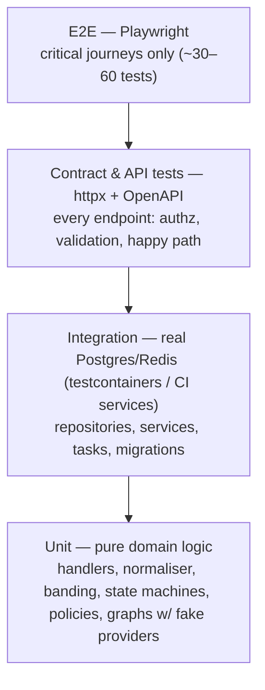

# IELTS MASTER 2.0 — Testing Strategy

| Field | Value |
|---|---|
| Status | **Draft v0.2 — revised after Phase 1 audit; awaiting approval** |
| Principle | No feature is reported as working without automated evidence. Unverified work is labelled as such |
| Last updated | 2026-11-17 |

---

## 1. Test Pyramid

Plus cross-cutting suites: **AI evaluation**, **load (k6)**, **security scans**, **accessibility**.

## 2. Coverage & Gates

| Area | Gate |
|---|---|
| Backend domain/services | ≥ 80% line, ≥ 70% branch (diff coverage ≥ 80% on PRs) |
| Question handlers, banding, exam state machine, authz policies | **100% of rule tables covered** (truth-table tests) |
| ai-engine graphs (fake providers) | ≥ 80% |
| Frontend components with logic | component tests for question renderers, exam shell, forms |
| Critical e2e journeys | must pass before staging → production |

Coverage is a signal, not a goal. Reviewers reject tests without meaningful assertions.

## 3. Backend

### 3.1 Unit (pytest)
- Pure functions/classes with no I/O. Injectable clock and ID generators.
- Hypothesis property tests for the normaliser, banding rounding, revision ordering.

### 3.2 Integration
- Real PostgreSQL (same major version + pgvector) and Redis. Configured by `TEST_DATABASE_ADMIN_URL` (a role that may CREATE/DROP DATABASE) and `TEST_REDIS_URL`. The suite creates a fresh `ielts_test` database per session and drops it afterwards (it refuses to touch any other database). Tests that need commits create and drop their own tables. Without these variables the integration tests are **skipped locally**. CI sets `REQUIRE_INTEGRATION_TESTS=1`, which turns a missing configuration into a failure.
- Celery tasks executed eagerly **and** via a real worker in a dedicated suite (to catch serialization/ack issues).
- Migration tests: `upgrade head` from empty, `downgrade base` / `upgrade head` round trip, idempotent re-upgrade, `alembic check` for model drift, single-head and revision-ID rules (`backend/tests/test_migrations.py`).

### 3.3 API & Authorization matrix
- An auto-generated test matrix enumerates every route from the FastAPI app and asserts each has declared auth requirements, so a new route without an auth declaration fails CI.
- For each route: unauthenticated → 401, wrong role → 403, **other user's resource → 404**, invalid payload → 422, happy path → 2xx with schema validation of the response.
- Key-leakage tests: student-facing content endpoints never include `answer_keys`, `answer_variants`, or exam-mode explanations (deep JSON scan).

### 3.4 Critical scenario tests (must exist before the relevant phase closes)
| Scenario | Phase |
|---|---|
| Refresh-token reuse revokes session family | 3 |
| Role removal takes effect on next request | 3 |
| Concurrent autosaves (two clients) → highest revision wins | 7 |
| Out-of-order / duplicated autosaves are no-ops; stale writer epoch → 409 after takeover; same-lease journal replay after reload accepted | 7 |
| Autosave racing submit: every 200-acknowledged answer is in the scoring input | 7 |
| Suspended user / revoked session rejected before access-token expiry | 3 |
| CSRF token from another session rejected (signed double-submit) | 3 |
| No egress started without `audio_recording` consent; consent withdrawal stops egress | 10 |
| `verify_claims` drops fabricated error claims in a seeded adversarial set | 9 |
| Save after deadline + grace rejected; within grace accepted | 7 |
| Sweeper auto-submits abandoned attempts; scoring idempotent when run twice | 7 |
| Submit called concurrently 10× → one submission, same response | 7 |
| Publishing archives the previous version atomically; attempts on old version still render & score | 5 |
| Import dry-run never writes content rows | 5 |
| Quota reservation + refund on evaluation failure; no double charge on retry | 8 |
| Webhook replay processed once; invalid signature rejected | 12 |
| Recording purge job deletes objects and DB refs after retention | 10 |

## 4. Frontend

- **Component tests (in place since Phase 4):** Vitest + jsdom + Testing Library + user-event, with axe-core through `src/test/axe.ts` (`color-contrast` disabled in jsdom; token contrast via `scripts/check_contrast.py`; page-level landmark checks run against `document`). Planned next: question renderers (controlled value round-trip, keyboard operation), exam timer display (offset-based), autosave queue logic (pure TS module, unit-tested with fake timers and a fake network).
- **E2E (Playwright)**, *deferred by decision 2026-11-17 (with the Lighthouse a11y ≥ 95 check); not installed yet*, against a full stack in Docker with seeded test data:
  1. Register → verify email (Mailpit) → login → logout.
  2. Browse library → start Reading practice → instant feedback → submit → review.
  3. Reading exam: answer, **go offline 30 s, keep answering, reload**, come back online, verify all answers persisted, submit.
  4. Listening exam: single-play enforcement, auto-submit at (shortened) deadline.
  5. Writing: autosave, submit for evaluation (fake AI provider in e2e env), view report.
  6. Speaking: session creation + consent gate (media is faked with a Chromium fake audio device; the real agent loop is covered in voice-engine integration tests).
  7. CMS: create draft → import JSON → validate → review → publish → visible in library.
  8. RBAC: content manager cannot publish; student cannot open admin.
- Cross-browser: Chromium on every PR; Firefox + WebKit nightly. Mobile viewport for student flows.
- Visual regression (optional, Phase 4+): Playwright screenshots for design-system components.

## 5. AI Testing

| Layer | What | When |
|---|---|---|
| Schema tests | Every structured output model round-trips; invalid outputs trigger repair/failure paths | every PR |
| Graph tests with fake providers | Node routing, retries, fallback, evidence-verification drops fabricated quotes, consistency rules, injection inputs rejected | every PR |
| Recorded-fixture regression | Small fixed set (~30 essays) replayed with recorded model responses: checks deterministic post-processing doesn't regress | every PR |
| Live benchmark | Full benchmark set (§8 of AI doc) on candidate prompt/model: MAE, within-±0.5, QWK, variance, cost, latency vs baseline thresholds | nightly + required for prompt/model/graph changes |
| Provider failure tests | Timeouts, 429s, malformed JSON, partial streams → retries/fallback/clean failure | every PR (fakes) |
| Prompt version tests | Prompt files have valid front-matter, render with sample variables, hashes registered; changing a prompt without bumping its version fails CI | every PR |
| Red-team set | Injection, abusive content, off-topic, memorised essays, non-English | nightly |

Benchmark results are stored as `evaluation_runs` and linked from the PR.

## 6. Voice Engine

- Unit: examiner state machine (time-travel tests for part durations), filler/repetition detection, turn-taking parameter selection per part.
- Integration: local LiveKit server + agent + synthetic participant streaming WAV fixtures. Asserts greeting, part transitions, interruption handling, and graceful end on provider failure (fake providers).
- Latency harness: measures per-stage latency with real providers in staging (nightly), reports p50/p95.

## 7. Performance (k6)

| Scenario | Target |
|---|---|
| 1,000 concurrent exam attempts, autosave every ~10 s, periodic navigation | p95 autosave < 150 ms, error rate < 0.1% |
| Exam start burst (200 starts in 60 s) | p95 < 800 ms |
| Library browsing (cached) 500 rps | p95 < 200 ms |
| Writing evaluation burst (500 submissions) | queue drains within SLA; no task loss; provider rate limits respected |
| Speaking: N synthetic sessions per voice worker | find capacity where p95 turn latency < 2 s |

Run on staging (prod-sized for the test) before production launch and after major changes.

## 8. Security Testing

Every PR: gitleaks, pip-audit, pnpm audit/OSV, Semgrep, Bandit. Images: Trivy (block critical). Staging: OWASP ZAP baseline per release, and a full authenticated scan in Phase 12. Pre-launch: external penetration test (recommended).

## 9. Infrastructure Tests

Docker health checks for every service. Compose smoke test in CI (`docker compose up` → health endpoints green). Backup restore drill monthly (documented evidence).

## 10. Test Data Policy

- Fixtures and dev seeds are **clearly synthetic** (e.g., "Sample Book — Test Only"), live under `tests/fixtures` / `scripts/seed_dev`, and are never loaded into production.
- No real student data in non-production environments. Production data for debugging only via approved, audited, minimised access.
- Licensed content may be used in staging only if the licence permits.

## 11. Reporting

CI publishes JUnit, coverage, Playwright traces/videos on failure, k6 summaries, and AI benchmark reports. Task summaries state exactly which tests ran and their results, and anything not tested is reported as **unverified**.
